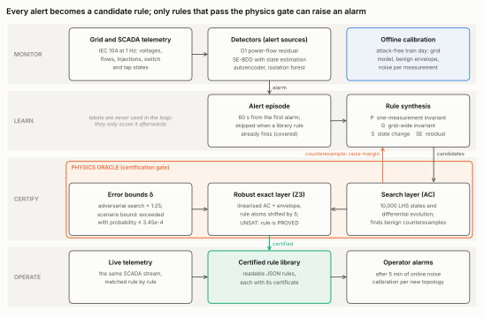
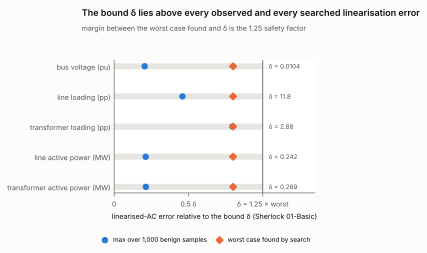
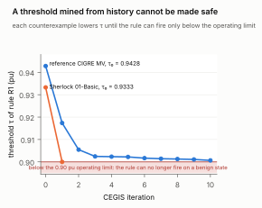
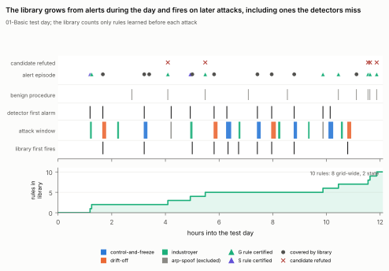
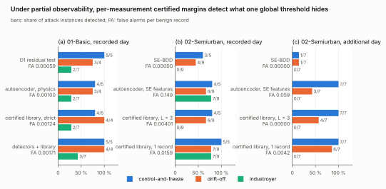
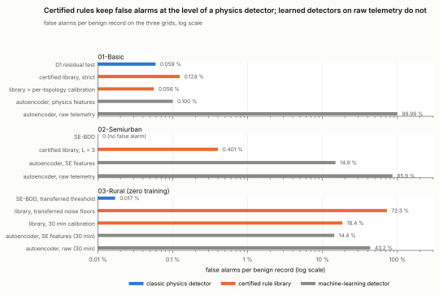
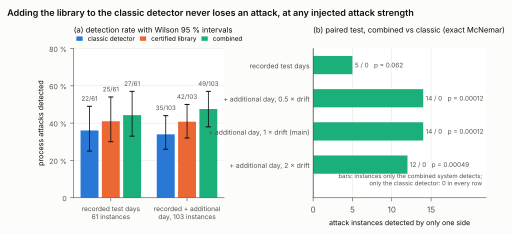
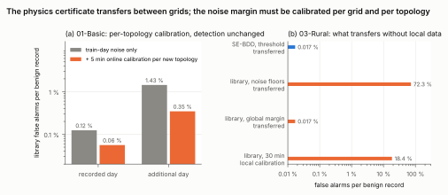
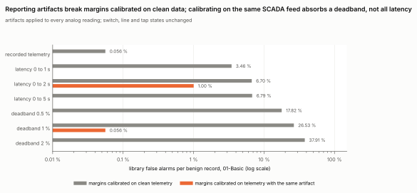

# From Alerts to Certified Rules: Self-Consolidating Intrusion Detection for Power Grids

---

## Abstract

Anomaly detectors on power-grid telemetry raise alerts, but each alert is consumed and forgotten: nothing durable, inspectable or auditable remains, and the next similar attack is detected, or missed, from scratch. Hand-written detection rules are durable but brittle, because benign operating changes (load variation, reconfiguration, tap changes, maintenance) trigger them. We propose a self-consolidating intrusion detection system that turns every alert into deterministic detection rules and admits a rule into a library only after a **physics oracle** has certified that no benign, physically feasible operating state triggers it. The oracle has a search layer (sampling and differential evolution over AC power flows) and an exact layer (an SMT solver over a linearised AC model, made robust by adversarially validated model-error bounds, or an affine worst-case bound for state-estimation residual rules); counterexamples refine the rules. We show why the exact layer is needed: on a partially observed grid, rules that passed 19,500 random benign states were refuted by benign states at the corners of the envelope, and only the worst-case bound made them sound. We evaluate on the public Sherlock dataset, on three distribution grids reconstructed from data and validated at the measurement noise floor: a fully observed 15-bus CIGRE grid, a 178-bus SimBench semi-urban grid with about 40 % of elements unmonitored, and a 99-bus rural grid used as a zero-training transfer target. On the recorded test days (61 process-attack instances), adding the certified library to a classic physics detector raises detection from 36 % to 44 %, with 5 instances caught only by the combination and none only by the detector (exact McNemar test, p = 0.062). Adding an independently calibrated semi-synthetic test day with 42 injected attacks gives 13 against 0 (p = 0.00024); the direction holds in each of five injection seeds (25 against 0 over 218 instances) and when the injected attack strength is halved or doubled. The gain is concentrated on the partially observed grid, where the proved library detects 10 of 21 injected attacks at zero false alarms against 2 for state-estimation bad-data detection. On the fully observed grid, scored with the dataset's own metrics, the combination detects 14 of 18 attacks at 10 false alarms, against 16 and 15 at 33 and 94 for the best published detectors. Under emulated SCADA latency and deadbands, margins reduced online by the observable reporting uncertainty keep the library at its clean false-alarm level. Attacks through valid switching commands stay physically consistent and are outside the reach of such rules, and a temporal accumulation of certified residuals failed to narrow the remaining stealth band; we report both.

**Index Terms**: intrusion detection, cyber-physical security, power distribution grids, SMT solving, counterexample-guided synthesis, state estimation, SCADA.

---

## I. Introduction

The control centre of a distribution grid receives thousands of measurements per second over legacy protocols such as IEC 60870-5-104, and sends commands over the same channels. The 2015 and 2016 attacks on the Ukrainian grid [1], and the more than 200 cyber incidents recorded against the German energy sector between 2023 and 2024 [2], [14], show two attacker options: falsify what the operator sees, or issue valid commands that change the physical grid. Industrial intrusion detection systems (IIDS) are the accepted retrofittable defence [3], [4]. Two families dominate. **Anomaly detectors**, physics-based or learned, compare telemetry with a model of normal behaviour and raise alerts. **Rule-based detectors** encode what an operator knows should never happen. Each family has a well-known weakness. Alerts leave no durable knowledge: the detector that flagged a frozen RTU today has no memory of it tomorrow, and an analyst cannot inspect why it fired. Rules are durable and inspectable, but every benign operating change that their author did not foresee becomes a false alarm, and in a distribution grid such changes are the norm: loads follow profiles, DER output follows weather, operators reconfigure feeders, change transformer taps and take lines out for maintenance.

This paper proposes to close the gap between the two families with a **certification gate**. An anomaly engine runs continuously. Each time it raises an alert that no rule in the library covers, the system synthesises candidate rules from the telemetry around the alert. A candidate enters the library only after a **physics oracle** has searched for a benign, physically feasible operating state that would trigger it, that is, a false alarm, and found none. Counterexamples found by the oracle are returned to the synthesiser, which refines the rule (counterexample-guided inductive synthesis, CEGIS [5]). The result is a library of deterministic rules, each with a certificate that says "no state inside the benign operating envelope of this grid fires this rule, up to a validated model error". The library grows with every incident, is inspectable rule by rule, and detects later attacks on its own.

The idea is simple to state and hard to make work. The oracle needs a grid model (the dataset contains none; all three were reconstructed from telemetry), a definition of "benign and feasible" an operator would sign, a search that reaches the corners of a high-dimensional envelope with hundreds of topologies, an exact layer that proves absence, and a noise model that keeps a certified rule from firing on noise. The contributions are:

1. **A two-layer physics oracle for detection rules.** A search layer over the full AC power flow and an exact layer that encodes envelope, linearised AC power flow and rule in linear real arithmetic for an SMT solver [6]. The exact layer is made *robust*: each AC condition is replaced by the weakest linear condition it implies under model-error bounds that are themselves validated by adversarial search, and the bounds carry a probabilistic guarantee from the scenario approach [7]. The linearised AC model covers meshed configurations, which LinDistFlow [8] does not, and makes power-balance rules certifiable.
2. **Rule synthesis from alerts** in three families, physical invariants (one measurement against its linear prediction from metered injections), grid-wide invariants per topology, and state rules (a discrete change not present in the benign envelope), with counterexample-guided refinement of margins. We publish the synthesised rules (Section VI-B).
3. **A self-consolidation loop** evaluated without labels: alerts come only from detectors, rules act only after they are learned, labels are used afterwards for scoring. We report a strict variant that credits a rule only with attacks that started after it was learned.
4. **Partial observability and unseen topologies.** For a 178-bus grid with about 40 % of elements unmonitored, the invariant becomes a state-estimation residual with pseudo-measurements and a Gauss-Newton correction against the full AC model, and each new topology's rule is proved on demand by an affine worst-case bound in about two minutes.
5. **Evaluation discipline.** Three reconstructed grids validated against ground truth, a zero-training transfer experiment, an additional independently calibrated test day with a sensitivity sweep over the injected attack strength, confidence intervals and paired tests under strict accounting (a rule is credited only with attacks that began after it was certified), seed and parameter ablations, and the negative results that shaped the design.

**Scope.** The rules synthesised here test the physical consistency and feasibility of a telemetry snapshot. They are the right tool against falsified telemetry (frozen or drifted readings), two of the three process-attack families in the dataset. Attacks through valid commands (the industroyer family) keep the telemetry consistent; the method catches them only when the resulting state lies outside the benign envelope (an islanded, dark zone), through state rules. On a fully observed grid with a strong residual detector, the library's main value is that its knowledge is durable and auditable, not that it detects more. Rules over command context and state transitions are future work (Section VII).

Section II reviews related work, Section III states the problem and threat model, Section IV the method, Section V the experimental setup, Section VI the results, Section VII the discussion and limitations, and Section VIII concludes.

---

## II. Related Work

**Process-aware intrusion detection.** Network-level IIDS inspect protocol fields and traffic patterns, and miss attacks that are syntactically valid [3]. Process-aware IIDS model the physical process state carried by the protocol. Hadžiosmanović et al. [9] mine value ranges and update patterns per variable from PLC traffic; Feng et al. [10] derive invariants for an industrial process from data with a systematic framework; Chen et al. [11] learn invariants with code mutation and Lin et al. [12] with graphical models and Bayesian networks. IPAL [13] gives a protocol-independent process-state representation on which such detectors can run; the Sherlock dataset [14] uses it and evaluates five recent IIDS, finding that none handles all of its attack types. Our work differs in two ways. The rules are not mined from history and trusted; they are synthesised from alerts and certified against the physics of the grid, and we show that a rule mined from history alone is refined into uselessness when made safe (Section VI-A). And the rule library is the output of an online loop fed by anomaly detectors, not a one-time specification.

**Physics-based attack detection and bad-data detection.** The residual between measurements and a physical model is the classic detection statistic, in state estimation as bad-data detection (BDD) [15] and in control systems as residual tests with persistence (CUSUM-style) [16], [17]. Liu, Ning and Reiter [18] showed that an attacker who knows the measurement model can craft false data that passes BDD, which spawned a large literature on stealthy false-data injection and its detection, surveyed in [19]. Our detectors D1 (full power flow) and SE-BDD (weighted least squares with a Gauss-Newton correction) are instances of this family and serve as the alert sources and as the classic baseline. The certified library differs from BDD in granularity: BDD has one global threshold on the largest normalised residual, whereas a certified rule has one margin per measurement, calibrated to that measurement's noise and to the oracle's bound for that topology. On the partially observed grid this difference accounts for the library's advantage (Section VI-E).

**Formal methods for rules and controllers.** SMT solvers [6] and CEGIS [5] are standard tools for synthesising programs and controllers from specifications and counterexamples. In power systems they have been used for verification of protection logic and of controller invariants, mostly with DC or linearised models. Our contribution is to use them as a *certification oracle for detection rules*, with a sound treatment of the linearisation error: the exact layer answers "no benign counterexample" only up to a model-error bound that we validate adversarially and bound probabilistically with the scenario approach of Calafiore and Campi [7].

**Machine learning for grid intrusion detection.** Autoencoders, isolation forests [20] and graph neural networks are widely proposed for anomaly detection on grid telemetry. The Sherlock dataset paper [14] reports that recent systems struggle with benign operating change. We confirm this on three grids: raw-feature detectors raise alarms on most benign records (Section VI-K), and physics-informed features fix it only where the training day covers the topologies of the test day. We use ML detectors as alert sources and baselines, not as the final decision.

**Datasets.** Sherlock [14], generated with the Wattson co-simulator [21] on CIGRE [22] and SimBench [23] grids, is the only public dataset we know of with recorded benign operator procedures (maintenance, ring closing, tap changes) interleaved with attacks on a distribution grid, which is exactly what a certification gate must survive. Its download contains no grid model, so we reconstruct the grids with pandapower [24] (Section V-B).

**Positioning.** Table I compares the proposed system with the closest lines of work on the properties this paper targets. Entries state what each cited paper reports; "not reported" means the paper does not address the property.

*Table I. Positioning against the closest prior work.*

| Work | Learns detection knowledge from data | Human-readable output | Checked against a physical model before use | Counterexample-guided refinement | Grows online from alerts | Partial observability |
| --- | --- | --- | --- | --- | --- | --- |
| Hadžiosmanović et al. [9] | per-variable prediction models from traffic | partly | no | no | no | not reported |
| Feng et al. [10] | invariant rules mined from data logs | yes | no (validated on data) | no | no | not reported |
| Chen et al. [11] | SVM invariant from code-mutation traces | no | statistical model checking on a simulator | no | no | not reported |
| TABOR [12] | timed automata and Bayesian networks | yes | no | no | no | not reported |
| SIMPLE [13] | value ranges, changes, distributions | yes | no | no | no | not reported |
| Bad-data detection [15], [18] | no (fixed residual statistic) | not applicable | yes (state-estimation model) | no | no | yes |
| Imhotep-SMT [27] | no (secure state estimator) | not applicable | yes (SMT over a linear model) | no | no | yes (sensor attacks) |
| **This paper** | rules synthesised from detector alerts | yes | yes: proved, by robust SMT (full observability) or an affine worst-case bound (partial observability) | yes | yes | yes |

The closest relatives either mine rules from data and trust them [9], [10], [12], [13], validate a learned model statistically once before deployment [11], or use a physical model to detect without producing reusable rules [15], [18], [27]. None turns alerts into rules that are checked against the physics before they can raise an alarm, and none grows its rule set online.

---

## III. Problem Statement and Threat Model

**System.** A distribution grid with buses $\mathcal{B}$, lines $\mathcal{L}$, transformers, loads, DER units and storage, operated from a control centre that receives a telemetry vector $m \in \mathbb{R}^n$ at 1 Hz: bus voltage magnitudes, line and transformer active-power flows, currents and loadings, injections of loads, DER and storage, switch states and tap positions. In the partially observed grid a fixed subset of elements has no telemetry.

**Benign envelope.** The set $\mathcal{E}$ of operating states an operator considers normal: load injections inside per-element ranges, controllable DER and storage over their physical ranges, load reactive power over its observed range, transformer taps in a set of positions, and a set of topologies (switch configurations) that keep the grid connected, with operating limits (bus voltage in $[0.90, 1.10]$ pu, line and transformer loading at most 100 %). A state is benign if it lies in $\mathcal{E}$ and its AC power flow converges within the limits.

**Attacker.** The attacker controls the communication path between RTUs and the control centre, or an RTU itself, and can (a) falsify reported measurements (drift a voltage reading, freeze a set of readings at stale values), and (b) send valid commands that change the physical grid (open a line, disconnect a generator or a load, change a set point). Attack (a) makes the telemetry physically inconsistent; attack (b) keeps it consistent but may create a state outside $\mathcal{E}$. We do not assume knowledge of the attack types at design time: rules are synthesised from whatever the detectors flag.

**Rule.** A rule $\rho$ is a Boolean function of $m$, written in a small language (Section IV-B). It fires on state $m$ if $\rho(m)$ holds. A rule is **certified** if no benign state fires it: $\forall s \in \mathcal{E}: \neg \rho(m(s))$, where $m(s)$ is the telemetry the AC power flow produces for $s$. We use two strengths of certificate and name them consistently. A rule is **proved** when the robust exact layer returns UNSAT: the property holds for every state of $\mathcal{E}$, up to a validated linearisation error. A rule is **search-validated** when only the AC search layer applies and no benign counterexample was found within its budget. Every P, G and S rule on the 15-bus grid is proved by the robust SMT layer; every SE rule on the partially observed grid is proved by an affine worst-case bound (Section IV-H). Search validation alone turned out to be unsafe there, and Section IV-I explains why. Measurement noise is treated separately: a certified rule is deployed with a margin at least the noise level observed on the grid (Section IV-E), and raising that margin never weakens the certificate.

**Goal.** Maintain a library $\mathcal{R}$ of certified rules, grown from detector alerts without labels, such that later attacks are detected by $\mathcal{R}$ with a false-alarm rate on benign records comparable to the detectors', and such that each rule can be read and audited.

---

## IV. Method

### A. Overview

Fig. 1 shows the loop. (1) Detectors watch the telemetry. (2) An alert opens a 60 s window. (3) If a rule in the library already fires within the window, the alert is covered and nothing is synthesised. (4) Otherwise candidate rules are synthesised from the window and the topology at the alert. (5) The physics oracle certifies or refutes each candidate; counterexamples refine margins. (6) Certified rules enter the library and act from the time they were learned.

*Fig. 1. End-to-end architecture in four lanes. Monitor: telemetry feeds the detectors, calibrated offline on an attack-free day. Learn: an alarm not already covered by the library opens a 60 s alert episode, from which candidate rules are synthesised. Certify: the search layer looks for a benign counterexample on the full AC power flow (a counterexample raises the margin); otherwise the robust exact layer proves the rule over the linearised model with error bounds δ. Operate: certified rules join the library and are matched against live telemetry after a short online noise calibration per new topology. Labels are never used inside the loop.*

### B. Rule language

A rule is a disjunction of conjunctions of atoms. Three atom types: a **threshold** on one measurement ($m_i < c$ or $m_i > c$), a **linear** inequality $\sum_k a_k m_k \lessgtr c$, and a **discrete** equality on a switch, line or tap state. Each atom has a scale that normalises units. The **margin** of a rule on a state is the maximum over clauses of the minimum over atoms of the atom margin ($(c - \text{lhs})/\text{scale}$ for $<$, the negative for $>$, $\pm 1$ for discrete atoms); the rule fires when the margin is positive. Margins give the search layer a continuous objective and make "how close to firing" comparable across rules. Rules are stored as JSON and are human-readable; Section VI-B lists the ones the loop produced.

### C. Benign envelope

The envelope is explicit and documented per grid. Continuous parameters: per-load active power as a fraction of nominal, within the range observed on the attack-free training day widened by 0.01; DER output in $[0, 1]$ of rated and storage in $[-1, 1]$ of nominal (operators change set points, and the test days contain benign set-point changes not seen in training); load reactive power either fixed at nominal or on its own observed range, whichever the data show. Discrete parameters: transformer tap positions seen in training (optionally padded by one step, Section VI-E), and topologies. For the 15-bus grid the topologies are enumerated: every switch configuration that keeps the grid connected with at most one closed loop and up to two lines out, 336 configurations (170 radial, 166 with one loop). For the 178-bus grid the topology space is structural (lines in or out of service) and each topology is certified when it first appears (Section IV-H). Benign operating limits are as in Section III.

### D. The physics oracle

**Search layer.** Stage A draws 10,000 Latin hypercube samples of the continuous parameters across configurations, solves each AC power flow, keeps the benign ones and records whether any fires the rule. Stage B runs differential evolution [25] on the rule margin, per configuration or jointly over the configuration index when there are many, with a fixed power-flow budget (32,000 per rule on the 15-bus grid). Power flows use a Newton-Raphson solver built on pandapower's admittance matrices, dense for small grids and sparse above 60 buses; it agrees with pandapower's `runpp` to $5.0 \times 10^{-7}$ over all measurements and runs in 2.2 ms against 35.2 ms per flow. The search layer gives a **refutation** when it finds a benign firing state (re-checked with `runpp`); it never proves absence.

**Exact layer.** Z3 [6] over linear real arithmetic with three parts: the envelope box and the configuration, a linear power flow model, and the rule. Two linear models are used. LinDistFlow [8] is radial only and ignores losses. The **linearised AC** model is the first-order expansion of the AC power flow at the envelope centre of each configuration; it covers meshed configurations, and its worst-case voltage error found by adversarial search is 0.00708 pu on the reference grid and 0.00834 pu on the 15-bus Sherlock grid, against 0.01204 and 0.01207 pu for LinDistFlow. UNSAT in the exact layer is a certificate *relative to the linear model*.

**Robust encoding.** Each AC condition is replaced by the weakest linear condition it implies under a model-error bound $\delta_q$ per quantity $q$: a rule atom $m_q > c$ becomes $\hat m_q > c - \delta_q$, and likewise for operating limits. UNSAT then means: no benign counterexample exists *provided the linear-to-AC error stays within $\delta$*. The $\delta_q$ are 1.25 times the larger of the sample maximum and the worst case found by differential evolution on the error itself (500 power flows per topology and quantity). For linear atoms over several measurements a rule-specific bound on the atom expression is tighter than the sum of per-quantity bounds (0.287 against 0.538 MW for the power-balance rule). Box-implied constraints are pruned before solving; queries run in parallel over configurations. A SAT model counts as a refutation only when re-checked as a benign AC counterexample; UNSAT in the robust encoding is a certificate; otherwise the search verdict stands.

**Probabilistic bound on the model error.** The adversarial search gives an empirical worst case, not a proof. We add a distribution-based guarantee: for $N$ = 20,000 independent benign states drawn uniformly over the envelope, every $\delta_q$ exceeds the sample maximum of the error, and by the scenario approach [7] a new benign state drawn the same way exceeds $\delta_q$ with probability at most $\epsilon = 1 - \beta^{1/N} = 3.45 \times 10^{-4}$ at confidence $1 - \beta = 0.999$. This bound is relative to the sampling distribution and is stated as such. The adversarial worst case is also stable under more search: with 4 and 8 times the budget (2,000 and 4,000 power flows per topology and quantity) the worst errors found grow by at most 2.6 % (line power 0.194 to 0.199 MW), and every one stays below the $\delta$ used, which still exceeds the largest by a factor of at least 1.22. A bound that is nevertheless too small makes the rule fire on a benign state, that is, a false alarm; it never hides an attack. Fig. 2 shows the three quantities per measured kind: the sample maximum, the adversarial worst case and the bound $\delta$ the exact layer uses.

*Fig. 2. Validated model-error bounds on the 01-Basic grid: for each quantity, the largest linearised-AC error over 1,000 benign samples, the worst case found by differential evolution, and the bound $\delta$ = 1.25 × worst that the robust exact layer uses.*

**Counterexample-guided refinement.** On a counterexample a threshold rule is tightened just past the counterexample value, and an invariant rule's margin is raised to the synthesis rule below with the updated oracle bound, for at most five rounds. The refinement trace is reported together with how much of the rule's original firing region remains, so that a rule refined into uselessness is visible (Section VI-A).

### E. Rule synthesis from alerts

**Physical invariant (family P).** For the topology $T$ at the alert and a reported quantity $y$ (a bus voltage or a line active-power flow), the linearised AC model gives $y \approx c_T + a_T^\top x$ where $x$ are the metered injections. The rule is $|y - c_T - a_T^\top x| > \mu$ with a discrete guard that the topology is $T$. The margin is

$$\mu = 1.5 \times \max(\text{noise}, \text{bound}),$$

where *noise* is the largest invariant residual over the attack-free training records in $T$ (floored by the largest residual over all training records when $T$ has fewer than 300 training records), and *bound* is the largest residual the oracle finds over benign AC states of $T$, times the 1.25 safety factor. The factor 1.5 was fixed before any result and must exceed the 1.25 bound safety factor (Section VI-G). Candidate quantities are those whose residual exceeds the noise in the alert window.

**Grid-wide invariant (family G).** One rule per topology with one clause per bus voltage and per active line flow, each the P invariant above in both signs. It fires when any monitored network quantity is inconsistent with the metered injections in that topology. One G rule covers every later falsification in that topology, so the loop synthesises it once per topology.

**State rule (family S).** A discrete change observed between the 30 s before the alert and the alert window: lines going out of service, loads, DER or storage going to zero. The candidate is the conjunction of these observations (thresholds at half the pre-alert value for injections). The oracle decides whether such a state exists in the benign envelope: an isolated zone with its loads at zero does not, a single DER at zero output does.

**State-estimation residual rule (family SE), partial observability.** Section IV-H.

### F. Self-consolidation loop and evaluation protocol

The test day is replayed in time order. Alerts come from detectors only. Alarm runs closer than 120 s form one episode. For each episode, in order: if the library fires within the first 60 s, the episode is covered; otherwise the G rule of the alert topology (if not yet in the library) and an S rule (if a state change is visible) are synthesised and certified, and certified rules enter the library. A rule acts only from the time it was learned. When the alert topology has fewer than 300 training records, its noise is calibrated online (Section IV-G) and the rule acts only after calibration. Labels are used only afterwards: per attack instance we record whether the detectors fired, whether the library fired through rules learned *before* the attack started (strict accounting), and the first firing times; per benign record (more than 60 s from any attack window) we record false alarms.

### G. Noise calibration, persistence and online per-topology calibration

A certificate covers physical variation, not telemetry noise. Noise is calibrated on the attack-free training day per measurement, with a floor per measurement kind (the median over the kind of the per-measurement 99.9th percentile), because a line idle in training would otherwise get a margin of zero. Where the loop meets a topology with too few training records, the first 300 s of records in that topology on which no detector alarms serve as calibration data, without labels; the rule acts afterwards. Raising a margin cannot break a certificate. A persistence filter (fire on $L$ consecutive records) is reported as an ablation and is part of the partially observed configuration ($L = 3$).

### H. Partial observability and on-demand certification

On the 178-bus grid 47 of 122 loads, 47 of 123 DER units, 47 of 114 storage units and 96 of 360 switches have no telemetry. The invariant becomes a state-estimation residual. Per topology, a weighted least-squares estimate uses the 559 monitored measurements (load P and Q included), pseudo-measurements for unmonitored load P and Q built from monitored loads of the same profile, and a weak prior; one Gauss-Newton correction against the full AC model follows, because the linear estimate alone hides small falsifications (the maximum residual on synthesised benign states fell from 12 to 0.06 noise standard deviations with the correction). Load reactive power had to be a free parameter: with Q fixed at nominal the residuals on real telemetry reached 72 to 86 sigma. De-energised buses are excluded. The SE rule of topology $T$ fires when some monitored measurement's normalised residual exceeds its margin $m_i = 1.5 \times \max(\text{noise}_i, \text{bound}_i(T))$. The bound is now **proved**, not searched. The normalised residual of the linear estimator is affine in the measurements, $r = R_n m + r_0$, and the measurements are, to first order, affine in the envelope parameters around the box centre (Jacobian of the AC model, 481 parameters). So the affine residual $r_{\text{aff}}(x) = g + G(x - x_0)$ has an exact maximum over the envelope box, $|g_i| + \sum_k |G_{ik}|(\bar x_k - \underline x_k)/2$. The remainder between the Gauss-Newton residual on AC measurements and $r_{\text{aff}}$ is bounded by $\delta_i$ = 1.25 × its largest value over 150 independent benign states and a differential evolution search, as for the linearised AC model of the 15-bus grid. $\text{bound}_i$ = box maximum + $\delta_i$ is an upper bound on $|r_i|$ over the benign envelope, valid up to $\delta$. The rule is then proved by construction, since its margin is at least 1.5 × that bound. Topologies are certified **on demand**: the first time one appears in telemetry, its rule is certified and acts from then on; the compute time is reported as latency.

---

### I. What a certificate guarantees, and under which assumptions

The two certificate strengths of Section III promise different things, and the paper keeps them apart.

**Assumptions.** (A1) The benign envelope $\mathcal{E}$ contains the operating states the operator considers normal (Section IV-C). (A2) The reconstructed grid model reproduces the physics of the real grid (validated at the measurement noise floor, Section V-B). (A3) For proved rules: on $\mathcal{E}$, the error of the linearised AC model is at most $\delta_q$ per quantity (validated adversarially; probabilistic bound below). (A4) Measurement noise on every reading stays below its calibrated noise level.

**Proposition 1 (proved rule).** If the robust exact layer returns UNSAT for rule $\rho$, then under (A1) to (A4) no benign state in $\mathcal{E}$ fires $\rho$. *Argument:* the robust encoding replaces each AC condition by the weakest linear condition it implies when the linear model is within $\delta$ of AC (A3); UNSAT of the weaker linear problem excludes every AC state of $\mathcal{E}$; the noise term of the margin covers (A4).

**Proposition 2 (SE rule, affine bound).** If every margin of an SE rule satisfies $m_i \ge$ box maximum$_i + \delta_i$, then under (A1), (A2), (A4) and the validity of $\delta$ no benign state in $\mathcal{E}$ fires the rule. *Argument:* $|r_i(x)| \le |r_{\text{aff},i}(x)| + \delta_i \le$ box maximum$_i + \delta_i$ for every benign $x$, and the box contains the benign set.

**Why search validation was not enough.** Our first version certified SE rules by search alone: 40 sampled states and a short differential evolution per topology. An independent check on 1,500 fresh uniform benign states per rule found no firing in 19,500 states, which bounds the firing probability by $4.6\times10^{-3}$ per rule under the *uniform* distribution. The affine bound then showed that this was not a guarantee. For about 38 % of the monitored measurements, the worst case over the envelope exceeded the margin. Checking the corresponding box corners on the full AC model confirmed **benign counterexamples in every topology**: 7 or 8 of 8 corners per topology were benign states (power flow converges, every limit holds) that fired a rule, with scores up to 2.9. In 481 dimensions, uniform sampling almost never reaches states where unmonitored loads move against their monitored profile, which is exactly where the pseudo-measurements fail. The search layer's counterexamples are what the method is designed to act on: CEGIS raised the margins to the proven bound (between 204 and 303 margins per topology), and the rule became proved. Section VI-C reports that this cost one detected instance and reduced false alarms. The lesson generalises: in high dimension, "no counterexample found" by sampling is not evidence of absence, and an exact or affine worst case should be computed wherever the rule permits.

**What is not guaranteed.** (i) Both statements are relative to $\mathcal{E}$: a benign action outside it (the unseen tap position of Section VI-E) can fire a rule. (ii) The remainder bounds $\delta$ in both propositions are validated by sampling and search, with a scenario bound relative to the uniform distribution; they are not worst-case proofs. (iii) A certificate is tied to the grid model, the envelope and $\delta$: when any of them changes (a new DER, a re-rated line, an extended envelope), the affected rules must be re-certified; Section VI-J reports the cost. (iv) Every failure of an assumption shows up as a false alarm, never as a missed attack: a certificate never makes a rule fire less.

## V. Experimental Setup

### A. Dataset

Sherlock [14] (Zenodo record 18467070) provides, per scenario, an attack-free training day and a test day with attacks and benign operator procedures, as IEC 104 captures, IPAL process states at 1 Hz from the control-centre vantage point, ground-truth physical snapshots and labels. We use the process states as telemetry and the snapshots only to validate reconstructions and to measure attack anatomy. Table II summarises the three scenarios. Attack types: **control-and-freeze** (telemetry of an area frozen while the grid changes), **drift-off** (voltage readings drifted away from the truth), **industroyer** (valid switching and disconnection commands) and **arp-spoof-dos** (a network attack; excluded from the process-attack evaluation by a decision taken before the experiments, and reported separately).

*Table II. Scenarios.*

| | 01-Basic | 02-Semiurban | 03-Rural |
| --- | --- | --- | --- |
| Base grid | CIGRE MV, all DER | SimBench 1-MV-semiurb--2-sw plus 56 DER-and-storage transformer groups | SimBench 1-MV-rural--2-sw |
| Buses / transformers / switches | 15 / 2 / 32 | 178 / 58 / 360 | 99 / 2 / 204 |
| Telemetry | fully monitored, 1 Hz | about 40 % unmonitored; every 5th record used | about 40 % unmonitored; every 5th record used |
| Training day | yes | yes | **none** |
| Test attacks (CFC / drift-off / industroyer / arp) | 5 / 4 / 7 / 2 | 5 / 9 / 9 / 6 | 5 / 9 / 8 / 6 |

### B. Grid reconstruction

The download contains no grid model. Each grid was reconstructed from data and validated against the ground-truth snapshots:

- **01-Basic**: pandapower's CIGRE MV network with all DER; the 24 line switches were mapped from the data (an open mapped switch carries less than 1 W at its line end in 172 of 172 cases); transformer impedances and iron losses were fitted to recorded losses; the tap changer was identified as HV side, 1.5 % per step, on held-out snapshots (voltage error 2.68e-4 pu mean with the identified tap against 1.23e-2 pu ignoring it).
- **02-Semiurban**: SimBench 1-MV-semiurb--2-sw plus 56 RTU groups, each a new bus with a 0.63 MVA transformer, a DER unit and a storage unit, found from the IEC 104 point map and bus power balances (maximum balance error 5.69e-5 MW).
- **03-Rural**: exactly SimBench 1-MV-rural--2-sw; fitted transformers match SimBench (vk 11.99 % against 12.00 %).

*Table III. Reconstruction accuracy against ground truth (100 random snapshots; mean / maximum absolute error).*

| Grid | Bus voltage, pu | Line P, MW | Transformer P, MW |
| --- | --- | --- | --- |
| 01-Basic, published parameters | 1.23e-3 / 3.25e-3 | 2.61e-5 / 1.08e-3 | 3.38e-2 / 7.20e-2 |
| 01-Basic, after identification | 2.60e-4 / 1.06e-3 | 3.69e-6 / 1.98e-4 | 3.83e-4 / 5.00e-4 |
| 02-Semiurban (test day) | 2.75e-4 / 1.03e-3 | 6.74e-6 / 2.07e-4 | 3.18e-6 / 3.81e-4 |
| 03-Rural (test day) | 2.86e-4 / 1.01e-3 | 5.23e-6 / 2.92e-4 | 6.29e-5 / 3.45e-4 |

The measurement noise floor, the largest difference between the same voltage recorded twice (bus and line end), is 5.0e-4 pu. All three reconstructions reproduce the recorded voltages at that level.

### C. Detectors and calibration

- **D1** (01-Basic): AC power flow from the metered injections, switch and tap states; residual = largest absolute difference against reported bus voltages, line P and transformer P; alarm when a residual stays above $\theta = 2 \times$ its training 99.9th percentile for $L$ records, $L$ = 1.5 × the longest training run above $\theta$ (here $\theta_{vm}$ = 2.50e-3 pu, $L$ = 9).
- **SE-BDD** (02-Semiurban, 03-Rural): the state estimator of Section IV-H; score = largest normalised residual; alarm when the score exceeds $2 \times$ the training 99.9th percentile ($\theta$ = 170.45) for $L$ = 3 records.
- **ML**: an MLP autoencoder (64-12-64) and an isolation forest (200 trees), each on raw telemetry or on physics-informed features (D1 or SE residual vectors plus rates of change), fit on the first 75 % of the training day, threshold at the 99.95th percentile of scores on the last 25 %, with persistence.

All thresholds and noise levels come from the training day only. On 03-Rural, which has no training day, nothing is calibrated on Rural data: envelope, thresholds and noise floors are transferred (Section VI-D).

### D. Metrics and statistics

Per attack instance: detected if any alarm falls in [start, recovery]; first-alarm delay. Per benign record: false-alarm rate and false-alarm episodes per benign hour. Wilson 95 % intervals for detection rates, exact Poisson (Garwood) intervals for episode rates, and the exact McNemar test (two-sided binomial on discordant instances) for paired comparisons between methods on the same instances. Seeds: 7 for all main results, 8 and 9 for robustness. Every script runs in under 10 minutes on a 4-core CPU; package versions are in `reports/env.txt` (pandapower 3.5.6, z3-solver 5.4.1, simbench 1.6.3).

---

## VI. Results

### A. The oracle separates sound rules from mined ones

Three hand-written rules test the oracle before any synthesis (Table IV). R1 is a naive voltage threshold mined from a narrow training envelope; R2 a context rule (line loading above the training 99th percentile *and* downstream load below the 1st percentile); R3 the active-power balance of the grid with a margin calibrated by search.

*Table IV. Oracle verdicts, robust exact layer with the linearised AC model. All verdicts agree with the AC search layer.*

| Rule | Reference CIGRE MV (16 configurations) | Sherlock 01-Basic (336 configurations) |
| --- | --- | --- |
| R1: $v_6 < 0.9333$ pu | refuted (253 of 9,671 benign samples fire it) | refuted (204 of 9,999; 281 of 336 configurations SAT) |
| R2: loading$_0$ > 83.7 % and downstream load < 0.919 MW | refuted | certified (336 UNSAT, 104 s total) |
| R3: $\lvert \sum P_{hv} - \sum P_{load} - \sum P_{sto} + \sum P_{der} \rvert > m$ | certified | certified (336 UNSAT, 13 s total) |

Two observations carry over to synthesis. First, calibrating R3's margin by sampling is unsafe: 2,000 samples gave a maximum benign residual of 0.3758 MW, and differential evolution found 0.6048 MW in the Sherlock envelope; the margin is therefore $1.5 \times$ the search maximum. Second, **a safe threshold mined from history is a useless one**: CEGIS on R1 lowers $\tau$ from 0.93327 to 0.89998 pu, below the 0.90 pu operating limit, leaving 0.0000 of the original firing band. Synthesis must therefore produce context and invariant rules, not thresholds (Fig. 3).

*Fig. 3. Counterexample-guided refinement of the mined threshold rule R1 on both grids: the threshold is driven below the 0.90 pu operating limit, leaving no firing region.*

### B. The certified rules

This section lists the rules the method produced on 01-Basic, in the form the library stores them. Measurement names are those of the telemetry: `vm_pu.b` bus voltage, `p_from.l` line active power at the from end, `load_p.i`, `sgen_p.i`, `storage_p.i` injections in MW, `line_in.l` the line's in-service state.

**Consolidation library (10 rules, 8 G and 2 S)**. Rules are shown as stored; the reading on the right is ours.

1. **S, learned at 4,293 s from an industroyer alert (two switches opened).** `line_in.2 = 0 ∧ line_in.3 = 0 ∧ load_p.2 < 0.0043 ∧ load_p.3 < 0.0073 ∧ load_p.4 < 0.0055 ∧ sgen_p.1 < 0.0002 ∧ sgen_p.2 < 0.0003 ∧ sgen_p.3 < 0.0003 ∧ sgen_p.9 < 0.0003 ∧ storage_p.0 ≈ 0`. Reading: the zone behind lines 2 and 3 is islanded and dark; no benign state in the envelope has it.
2. **G, base topology, learned at 4,505 s from a drift-off alert.** `G@ties=none;out=none;tap=0,0`: 58 clauses, one per bus voltage and per active line flow and sign, each of the form `vm_pu.10 − (0.98706 + Σᵢ aᵢ·load_p.i − Σⱼ aⱼ·sgen_p.j − Σₖ aₖ·storage_p.k) > 0.00722` under the guard "all lines in, taps at 0". Reading: a reported network quantity is inconsistent with the metered injections.
3. **G, learned at 14,729 s.** `G@ties=S2;out=L4;tap=0,0` (56 clauses): the same invariant after a benign maintenance reconfiguration (line 4 out, tie S2 closed).
4. **S, learned at 17,737 s from an industroyer alert.** `line_in.3 = 0 ∧ load_p.3 < 0.0073 ∧ sgen_p.2 < 0.0003 ∧ sgen_p.9 < 0.0003`: line 3 out with its load and both DER units dark.
5. **G, learned at 19,744 s.** `G@ties=S1+S2;out=L4+L11;tap=0,0` (54 clauses): two lines out, two ties closed.
6. **G.** `G@ties=S1+S2;out=L11;tap=0,0` (56 clauses), for example `vm_pu.1 − Σ aᵢ xᵢ > 1.00761` with 31 injection terms.
7. **G.** `G@ties=S1+S2;out=L11;tap=-1,0` (56 clauses): the same topology after a benign tap change on transformer 0.
8. **G.** `G@ties=S1+S2;out=L9;tap=0,0` (56 clauses).
9. **G.** `G@ties=S1+S2+S3;out=L7+L9;tap=0,0` (54 clauses), a meshed configuration.
10. **G.** `G@ties=S1+S2+S3;out=L8+L9;tap=0,0` (54 clauses), a meshed configuration.

Fig. 4 shows the loop over the test day: when each rule was learned, which alerts were already covered, which candidates the oracle refused, and when the detectors and the library first fired on each attack.

*Fig. 4. The self-consolidation loop on the 01-Basic test day. Top: attack windows by type, benign operator procedures, first alarms of the detectors and of the library (rules learned before the attack only), alert episodes (certified G or S rule, covered by the library) and refuted candidates. Bottom: library size.*

**Refuted candidates** (the oracle found a benign state that fires them): `S-line 4 out` and `S-line 11 out` (a line out of service alone is benign maintenance), `S-sgen_p.0 to zero` (refuted by search: a DER at zero output is benign) and `S-sgen_p.6 to zero ∧ sgen_p.12 to zero` (refuted by the exact layer). These refutations are the point of the gate: each would have been a plausible hand-written rule and a source of false alarms.

**Single-measurement invariants synthesised from labelled alerts** (family P, offline synthesis study, 12 certified of 14 candidates): `P-vm10@base`, margin 0.00722 pu (from a drift-off); `P-vm14@base`, 0.00209 pu, and `P-p11@base`, 0.00644 MW (from a control-and-freeze); `P-vm3`, `P-vm6`, `P-vm2@ties=S1+S2;out=L4+L11`, margins 0.00712, 0.00732, 0.00551 pu; `P-p1@ties=S1+S2;out=L4+L11`, 0.153 MW and, after a second alert, 0.0915 MW; `S-load_p.9 ∧ load_p.17 to zero`; `S-load_p.16 to zero`. The certified rules fired on at most 0.0003 of benign test records each.

**Partially observed grid (02-Semiurban).** The library holds one SE rule per topology, 13 by the end of the test day, each of the form "some monitored residual $|r_i|$ exceeds $m_i$", with per-kind noise floors in units of sigma: load P 0.16, load Q 0.34, line P 1.64, DER P 0.16, storage P 0.16, transformer P 0.47, bus voltage 2.50. The topology labels are readable, for example `out=L20+L113+L114+L115+L116+L117+L119+L120` for the initial configuration and `out=L4+L7+L21+L42+L53+L109+L115+L116+L117` for the last.

### C. Main comparison on the recorded test days

*Fig. 5. Instances detected per attack type and method on the recorded test days and on the additional day of 02-Semiurban, with false alarms per benign record.*

*Fig. 6. False alarms per benign record on the three grids, log scale. Classic physics detectors and the certified library sit two to three orders of magnitude below machine-learning detectors on raw telemetry; on 03-Rural the library needs local noise calibration.*

*Table V. Detection per attack type (instances detected / instances), mean first-alarm delay over detected process attacks, and false alarms per benign record.*

| Grid | Method | CFC | drift-off | industroyer | delay s | FA / record |
| --- | --- | --- | --- | --- | --- | --- |
| 01-Basic | D1 residual test | 5/5 | 3/4 | 2/7 | 78 | 0.00059 |
| 01-Basic | AE, raw telemetry | 5/5 | 4/4 | 7/7 | 1 | **0.99988** |
| 01-Basic | AE, physics-informed | 4/5 | 3/4 | 2/7 | 92 | 0.00100 |
| 01-Basic | Detectors D1 or AE (alert source) | 5/5 | 3/4 | 2/7 | 77 | 0.00109 |
| 01-Basic | Certified library, strict | 4/5 | **4/4** | 2/7 | 102 | 0.00124 |
| 01-Basic | Combined: detectors or library | 5/5 | 4/4 | **3/7** | **68** | 0.00171 |
| 02-Semiurban | SE-BDD | 3/5 | 4/9 | 0/9 | 261 | 0.00000 |
| 02-Semiurban | AE, raw telemetry | 5/5 | 9/9 | 9/9 | 19 | **0.85948** |
| 02-Semiurban | AE, SE-residual features | 4/5 | 6/9 | 7/9 | 121 | 0.14888 |
| 02-Semiurban | Certified library (proved), single record | 5/5 | 6/9 | 7/9 | 112 | 0.00889 |
| 02-Semiurban | Certified library (proved), L = 3 | **4/5** | **6/9** | 0/9 | 165 | **0.00017** |
| 02-Semiurban | Combined: SE-BDD or library (L = 3) | 4/5 | 6/9 | 0/9 | 165 | 0.00017 |

On the fully observed grid the library alone, under strict accounting, catches 4 of 4 drift-offs including the one D1 misses (D1: 3 of 4), and the combination adds one industroyer instance and cuts the mean delay from 77 to 68 s. The library alone is slower than D1 (102 s against 78 s): an invariant rule fires only once the falsification exceeds its margin. On the partially observed grid the library with persistence, now proved, detects more than SE-BDD (control-and-freeze 4/5 against 3/5, drift-off 6/9 against 4/9) at 0.00017 false alarms per record. With the earlier search-validated margins the same detections came with 0.00401 false alarms; the proof costs no detection here and removes most false alarms. All 13 test topologies (12 unseen in training) were proved on demand, with a latency of 120 s median and 160 s maximum on a shared 4-core machine. Strict accounting changes nothing here: every detected instance occurred in a topology whose rule was certified before the attack began. Industroyer, which changes the grid through valid commands and keeps the telemetry consistent, is caught by physics-consistency rules only through switching transients (single-record mode, 7/9 at 0.009 false alarms) or through state rules when the resulting state is outside the envelope.

### D. Zero-training transfer to 03-Rural

03-Rural has no training day (first attack at 39 minutes). Nothing was calibrated on Rural data: the active-power envelope comes from the public SimBench profiles widened by 0.05 (covers 100 % of benign monitored load P); reactive-power bounds and the SE-BDD threshold are transferred from 02-Semiurban.

- SE-BDD with the transferred threshold: drift-off 5/9, control-and-freeze 0/5, industroyer 0/8, false alarms 0.00017 per record. **The detector's global threshold transfers.**
- Certified library with transferred per-kind noise floors: detects nearly everything but at 0.723 false alarms per record with persistence, because Rural's transformer flow residuals reach 19 sigma against a transferred floor of 0.47. **Per-measurement noise does not transfer.** With the transferred global threshold as minimum margin (a decision taken after this failure, and reported as such) the flood disappears, but the library adds nothing over SE-BDD.
- Calibrating the library's noise on the first 30 minutes of the test day (attack free, excluded from evaluation) gives control-and-freeze 5/5, drift-off 8/9, industroyer 4/8 at 0.184 false alarms with persistence: 30 minutes do not cover a day's operating range.

The physics certificate itself needs no local data; the library's noise term needs a representative benign period on each grid.

### E. An additional, independently calibrated test day

Sherlock has one test day per scenario. For a second, independent test, each recorded training day (12 h, attack free) of 01-Basic and 02-Semiurban is split at its midpoint; every calibration (envelope, D1, SE-BDD, ML, noise) is redone on the first half, and 21 process attacks per grid are injected into the second half, modelled on the measured anatomy of the real ones: drift-off ramps whose final offset and bus count are drawn from the real instances of the same grid (bimodal: 0.036 to 0.39 pu on 1 to 6 buses, or about 0.0015 pu), control-and-freeze on an area of 3 or 10 buses, often with a line opened behind the freeze, and industroyer as a line opened or generators disconnected. Physical changes enter as an AC power-flow delta on the nearest ground-truth snapshot, so recorded noise and model mismatch are kept. A first model with guessed drift magnitudes (0.005 to 0.05 pu), run before the real ones were measured, is reported as a weak-attack sensitivity case; the measured model is the main result. The choice follows the anatomy, not the detection numbers (the weak model favoured the library more).

*Table VI. Split day, measured attack model.*

| Grid | Method | CFC | drift-off | industroyer | FA / record |
| --- | --- | --- | --- | --- | --- |
| 01-Basic | D1 | 7/7 | 4/7 | 0/7 | 0.00059 |
| 01-Basic | Certified library, strict | 4/7 | 2/7 | 0/7 | 0.01432 |
| 01-Basic | Library with per-topology calibration, strict | 4/7 | 2/7 | 0/7 | 0.00346 |
| 01-Basic | Combined (per-topology calibration) | 7/7 | 4/7 | 0/7 | 0.00425 |
| 02-Semiurban | SE-BDD | 1/7 | 1/7 | 0/7 | 0.00000 |
| 02-Semiurban | AE, SE-residual features | 7/7 | 3/7 | 0/7 | 0.05913 |
| 02-Semiurban | Certified library (proved), L = 3 | **6/7** | **4/7** | 0/7 | **0.00000** |

Every drift-off with a visible magnitude is caught (4 of 4 per grid); the three misses per grid are the near-zero instances (about 0.0015 pu). On the partially observed grid the proved library detects 10 of 21 at zero false alarms where SE-BDD detects 2 (8 discordant against 0, p = 0.008): one threshold at 138 sigma hides what per-measurement margins expose. On the fully observed grid D1 already catches every visible attack, and the library's false alarms came from benign records in a topology rare in the first half, where the real grid deviates from the reconstructed model by more than the training noise; online per-topology calibration (Section IV-G) cuts them from 0.0143 to 0.0035 per record with detection unchanged, and the remainder are runs of 2 to 6 records around benign operator actions. Industroyer is 0 for every method: injected switching is physically consistent by construction, and the real-day catches came partly from transients a power-flow delta does not reproduce. Finally, a benign command moved a transformer to a tap position unseen in the first half, after which synthesis stopped for two hours; padding the tap range by one step, with bounds re-validated for the padded envelope, restored certification: control-and-freeze 6/7 and drift-off 4/7, at 0.0181 false alarms per record without and 0.0043 with per-topology calibration.

**Sensitivity to the injected attack strength.** The injected attacks were regenerated with the measured drift magnitudes halved and doubled, with the same seed, so the instances differ only in magnitude, and every calibration was rerun (Table VI-a). The paired result does not depend on the attack model.

*Table VI-a. Additional day, combined system against the classic detector: instances detected only by one side, and the exact McNemar p-value.*

| Injected drift magnitude | 01-Basic D1 drift-off | 02-Semiurban SE-BDD / library, drift-off | Additional day alone | Pooled with recorded days |
| --- | --- | --- | --- | --- |
| guessed, 0.005 to 0.05 pu (v1) | 7/7 | 0/7 / 7/7 | 16 / 0, p < 0.001 | n/r |
| 0.5 × measured | 4/7 | 1/7 / 4/7 | 8 / 0, p = 0.008 | 13 / 0, p = 0.00024 |
| 1 × measured (main) | 4/7 | 1/7 / 4/7 | 8 / 0, p = 0.008 | 13 / 0, p = 0.00024 |
| 2 × measured | 7/7 | 4/7 / 4/7 | 5 / 0, p = 0.062 | 10 / 0, p = 0.0020 |

Stronger drifts help the detectors more than the library: the classic detectors' thresholds are crossed by large drifts, while the library already caught every visible drift at 1×. At 2× the additional day alone is no longer significant (5 against 0, p = 0.062); the gap narrows but never reverses, and the classic detector never catches an instance the combined system misses.

### F. Uncertainty and paired tests

*Table VII. Pooled over process attacks. Wilson 95 % intervals; exact McNemar test for combined against classic (D1 or SE-BDD).*

| | Recorded test days (61 instances) | Recorded days plus split day (103 instances) |
| --- | --- | --- |
| Classic detector | 22/61 = 0.36 [0.25, 0.49] | 35/103 = 0.34 [0.26, 0.44] |
| Certified library | 25/61 = 0.41 [0.30, 0.54] | 41/103 = 0.40 [0.31, 0.49] |
| Combined | 27/61 = 0.44 [0.33, 0.57] | 48/103 = 0.47 [0.37, 0.56] |
| Only combined / only classic detects | 5 / 0, p = 0.062 | 13 / 0, **p = 0.00024** |
| Same, strict accounting (rules certified before the attack) | 5 / 0, p = 0.062 | 13 / 0, p = 0.00024 |

*Fig. 7. (a) Pooled detection of process attacks with Wilson 95 % intervals. (b) Paired comparison of the combined system with the classic detector: instances only the combined system detects, with the exact McNemar p-value, for the recorded days alone and pooled with the additional day at three injected drift strengths; the classic detector alone never catches an instance the combined system misses.*

The combined system never loses an instance the classic detector catches. Per grid and day, the strongest paired evidence is on the partially observed grid.

### G. Robustness and ablations

- **Seeds 7, 8, 9** (oracle search, ML training): per-type detection identical on both grids; 01-Basic library false alarms 0.00115 to 0.00124. The 02-Semiurban seed and margin-factor ablations were run with the earlier search-validated margins, before the proof; detection per type matched the proved run.
- **Injection seeds** for the additional day (attack times, targets and magnitudes redrawn, every calibration rerun): the combined system catches more than the classic detector in every seed and never fewer: 8, 3, 6, 5 and 3 instances only it detects against 0, pooled 25 against 0 over 218 injected instances (Table VIII). The library alone detects about as much as the classic detector (79 against 80 of 218); the gain comes from complementarity, not from a stronger single detector. The seeds share one benign base day, so the pooled test is descriptive.
- **Persistence** on the library: $L$ = 1, 3, 5 gives 0.00124, 0.00091, 0.00065 false alarms on 01-Basic with unchanged detection; on 02-Semiurban (proved margins) $L$ = 3 removes the industroyer transients (7/9 to 0/9) and cuts false alarms from 0.00889 to 0.00017.
- **Margin factor**: at 1.25 the grid-wide rules cannot be certified on 01-Basic, because the robust bound (1.25 × oracle bound) is not below the margin, and the library is left with 3 state rules; 1.5 (default, fixed in advance) as reported; 2.0 gives the same detection at 0.00109 (01-Basic) and 0.00174 (02-Semiurban, search-validated margins). The margin factor must exceed the bound safety factor; above that it trades false alarms for delay.
- **Per-topology online calibration** (Section IV-G) on the recorded 01-Basic day: library false alarms 0.00124 to 0.00056 per record (0.64 to 0.21 episodes per hour), detection unchanged, now below D1's 0.85 episodes per hour. Fig. 8 summarises this and the Rural transfer.

- **Model error bounds**: all verdicts of the robust exact layer agree with the AC search layer on both grids; the scenario bound of Section IV-D holds for every quantity.

*Table VIII. Additional day with five injection seeds: process attacks detected, pooled over 01-Basic and 02-Semiurban, and the exact McNemar test of combined against classic.*

| Seed | Classic | Certified library | Combined | Only combined / only classic | McNemar p |
| --- | --- | --- | --- | --- | --- |
| 7 (main) | 13/42 | 16/42 | 21/42 | 8 / 0 | 0.0078 |
| 8 | 12/43 | 10/43 | 15/43 | 3 / 0 | 0.2500 |
| 9 | 17/45 | 19/45 | 23/45 | 6 / 0 | 0.0312 |
| 10 | 21/44 | 19/44 | 26/44 | 5 / 0 | 0.0625 |
| 11 | 17/44 | 15/44 | 20/44 | 3 / 0 | 0.2500 |
| All seeds (descriptive) | 80/218 | 79/218 | 105/218 | 25 / 0 | 5.96e-08 |

*Fig. 8. What calibration does. (a) 01-Basic: five minutes of label-free online calibration per unfamiliar topology cuts library false alarms by a factor of 2.2 on the recorded day and 4.1 on the additional day, with detection unchanged. (b) 03-Rural: the detector threshold transfers across grids, per-measurement noise floors do not, and 30 minutes of local data are not enough.*

### H. Comparison with published IDSs on the same test day

The dataset paper [14] evaluated five published process-aware IDSs on the 01-Basic test day with its own metrics: an *alarm* is a continuous run of alarm records; an attack counts as detected if an alarm *starts* inside it (all 18 attacks, arp-spoof included); alarms starting in the recovery phase are ignored; every other alarm start is a false alarm, of which those during or within 120 s after a benign procedure are given in brackets. We scored our methods the same way (Table IX). The published numbers were obtained after filtering measurements affected by switching and maintenance; ours use the unfiltered telemetry.

*Table IX. 01-Basic test day, metrics of the dataset paper. Published rows copied from Table 3 of [14].*

| IDS | Detected attacks | False alarms (at benign events) | Mean time to detection, s |
| --- | --- | --- | --- |
| PASAD [14] | 0/18 | 1 (0) | n/r |
| Invariant [14] | 0/18 | 1 (0) | n/r |
| Seq2SeqNN [14] | 7/18 | 10 (0) | 149.6 |
| SIMPLE [14] | 16/18 | 33 (33) | 81.4 |
| GeCo [14] | 15/18 | 94 (30) | 75.9 |
| D1 residual test (ours) | 12/18 | 8 (7) | 77.5 |
| Certified library (ours) | 11/18 | 6 (5) | 70.2 |
| Certified library with per-topology calibration (ours) | 11/18 | **2 (1)** | 70.2 |
| Combined: detectors or library (ours) | 14/18 | 10 (9) | 69.5 |

**Rerunning a published IDS on identical, unfiltered data.** To separate the effect of measurement filtering from the detector, we ran SIMPLE from the dataset group's open IPAL IDS framework (its five components with the framework's default parameters, any-component alarm) on exactly our training and test files, with every numeric and Boolean state field and no filtering. It alarms on 100 % of benign records (to five decimals) and inside all 16 process attacks: the unfiltered telemetry of a day with benign switching and maintenance contains values never seen in training, and SIMPLE's range and histogram components flag them all. By the dataset metric this is a single alarm that starts at the beginning of the day, so 0 of 18 detected and 1 false alarm, which shows that the metric rewards alarm starts, not alarm coverage. The published 16/18 therefore depends on the measurement filtering, which is a form of the benign knowledge the certification gate encodes explicitly. GeCo, with the framework's defaults (formulas of length up to 3 over all 325 numeric fields), did not finish training on 4 cores within 6 hours (a 2-hour run, then a 4-hour resumed run), so no like-for-like GeCo result is available; its published numbers rely on the filtered, smaller feature set.

The two published systems that detect most attacks pay for it with 33 and 94 false alarms on the day, most of them at benign operator procedures, which is exactly the failure the certification gate is designed to prevent. The combined system detects 14 of 18 at 10 false alarms; the calibrated library alone detects 11 of 18 at 2.

### I. Realistic SCADA reporting: reporting-robust margins

Sherlock's telemetry is a synchronous snapshot of a steady-state co-simulation. A control centre receives readings with latency and deadbands. We replayed the 01-Basic test day with these artifacts on every analog reading (switch, line and tap states unchanged). With plain margins calibrated on the clean recording, the library's false alarms rise from 0.056 % of benign records to 3.5 % with up to 1 or 2 s of latency, 6.9 % with up to 5 s, and 18 to 38 % with deadbands of 0.5 to 2 % of the training range (Fig. 9). Calibrating on a feed with the same artifacts absorbs a deadband (0.056 %) but not latency (0.80 % at 2 s): readings that lag by different amounts disagree during every ramp.

**Reporting-robust margins.** Every non-discrete atom of a rule is a weighted sum $\sum_j w_j m_j$. If each reading may lag by up to $\Delta$ seconds and is reported with deadband $b_j$, the reported sum differs from the synchronous one by at most $\sum_j |w_j| (V_j(t) + b_j)$, where $V_j(t)$ is the variation of reading $j$ over the last $\Delta$ seconds. The control centre observes this variation (we use the range of the reported values over the last $\Delta + 1$ records). Each atom's margin is reduced online by this amount, so a rule fires only when the inconsistency exceeds what reporting alone can explain. The physics certificate concerns the static margin and is unchanged; $\Delta$ and $b_j$ are declared configuration values (the maximum reporting delay and the configured deadbands), not fitted to test data. With these margins, a library calibrated on clean telemetry stays at the clean false-alarm level under every artifact: 0.041 to 0.053 % with latency up to 5 s, 0.047 % with deadbands up to 2 %, with detection (detectors or library) at 12/16 in every case, as on the clean day (Fig. 9). The protection costs little on clean telemetry: declaring $\Delta$ = 2 s leaves detection unchanged at 0.044 % false alarms, and $\Delta$ = 5 s costs one instance. These criteria were fixed before the experiment.

*Fig. 9. Library false alarms on the 01-Basic test day with reporting artifacts on every analog reading: plain margins calibrated on clean telemetry (gray), plain margins calibrated on telemetry with the same artifact (orange), and reporting-robust margins with clean calibration (green).*

**Stealth budget.** An attacker who knows the library can falsify a reading by up to its margin without firing a rule. Recovered from the stored grid-wide rules, voltage margins range from 0.0020 to 0.0264 pu (median 0.0073 pu, 112 clauses), against a measurement noise floor of 0.0005 pu. The real drift-off attacks on this grid moved a reading by 0.036 to 0.38 pu, or by about 0.0014 pu in the near-zero instances that no method detected. The library covers the physically significant falsifications and leaves a stealth band of about 1 % of nominal voltage. We tried to narrow it with a CUSUM on each certified residual, normalised by its margin, calibrated on attack-free data only. This failed its pre-registered criterion: false alarms rose to 71 % of benign records (64 % in an exploratory variant with a higher drift allowance). The certified residual carries a slowly varying benign bias, the model mismatch moving with the operating point, so the stealth band is set by model fidelity, not by measurement noise. A coordinated, physically consistent injection that falsifies injections and network quantities together [18] is outside the reach of every consistency check, certified or not.

### J. Cost and scalability

On 01-Basic, certifying a grid-wide rule (54 to 58 clauses; search layer plus robust exact layer over 336 configurations, 4 cores) took 17.6 to 60.6 s; a state rule 6.0 to 27.1 s when certified and 3.3 to 4.0 s when refuted by search. Evaluating the whole final library (10 rules, 446 clauses) on one telemetry record takes 1.7 ms in unoptimised Python on one core, against a 1 s reporting interval. On 02-Semiurban (178 buses), certifying and proving a topology's rule on demand took a median of 120 s (at most 160 s), of which the search layer alone took 5 to 10 s, and the library adds to the SE-BDD detector only a comparison of 559 residuals with their margins, since the state estimate is already computed. The library grows with the number of topologies met, not with the number of alerts: 10 rules for 22 alert episodes on 01-Basic, 13 topologies in a day on 02-Semiurban. When the model or envelope changes, every affected rule must be re-certified at these costs; re-certifying the whole 01-Basic library sequentially takes about 4.6 minutes (the sum of the measured certification times).

### K. Machine-learning detectors as a negative result

Autoencoders on raw telemetry raise alarms on 0.99988 (01-Basic), 0.85948 (02-Semiurban) and 0.43249 (03-Rural, trained on 30 minutes) of benign records, because loads, DER output and topology change through the day in ways the training day does not pin down. Physics-informed features repair this on the fully observed grid (0.00100) but not fully on the partially observed one (0.14888), whose test day has 12 topologies unseen in training. The isolation forest saturates and detects almost nothing with physics features on 01-Basic (0/5, 0/4, 0/7 at 0 false alarms). None of the ML detectors is close to the certified library's operating point.

---

## VII. Discussion

**What the certification gate buys.** Three things that neither detectors nor hand-written rules give on their own: durable, readable knowledge (Section VI-B is a complete list of what the system learned, each rule with the reason it holds); a guarantee against false alarms from physical variation inside a documented envelope; and refusal of plausible-but-wrong rules (a DER at zero, a line out) before they reach operations. The gain in detection over a well-calibrated classic detector is real but modest where the grid is fully observed, and large where it is not, because per-measurement margins resolve what a single global residual threshold averages away.

**How far the results generalise.** The evidence spans three grids of different size (15, 99 and 178 buses), observability (full and about 60 %) and origin (CIGRE and two SimBench families), a grid without any training data, an independently calibrated second day, and three attack strengths. What generalised: the oracle's verdicts, the physics certificate, the detector's global threshold, and the paired advantage of the combined system. What did not: per-measurement noise margins across grids and across reporting conditions. All results come from one co-simulator; a recording from a real control centre is the missing test.

**What transfers between grids and what does not.** The physics certificate needs no local data: on 03-Rural every topology was certified on demand. A detector's global threshold transferred between two grids of the same dataset family. Per-measurement noise did not transfer, and 30 minutes of local data were not enough. In deployment this means a benign calibration period of the order of a day per grid, and the online per-topology calibration of Section IV-G for topologies that period did not cover.

**The envelope matters more than the rule language.** Every failure mode we met was an envelope or calibration failure: a tap position not in the envelope, a topology rare in calibration, reactive power assumed fixed, a line idle in training. Engineering ranges (one tap step beyond those observed, every topology one benign procedure away) are the right default, with bounds re-validated when the envelope grows.

**What a utility must provide.** The envelope in this paper is learned from an attack-free recording plus engineering ranges for controllable assets. In deployment it would come from planning data and operating procedures: load and DER profiles per feeder (SimBench-style profiles covered 100 % of benign load P on 03-Rural, but only 10 % of load Q without local data), the switching configurations allowed by the operating manual, and the tap-changer range of each transformer. An envelope that is too narrow lets certified rules fire on benign states it omitted (the unseen tap position of Section VI-E); one that is too wide makes useful rules uncertifiable. The partially observed grid also uses one piece of planning knowledge that a utility would supply in a different form: which profile each unmonitored load follows, used to build its pseudo-measurement.

**Can the loop be poisoned?** The online per-topology calibration uses the first 300 s in a new topology on which no detector alarms. An attacker who falsifies telemetry below the detector threshold during exactly those 300 s would inflate the noise term and widen the margins of that topology's rule. The effect is bounded: the margin can only grow, so the rule stays certified and fires on a subset of what it fired on before; the attacker gains stealth, never a false alarm. Restricting calibration to topologies entered through a logged operator procedure, or capping the calibrated noise at a multiple of the training noise, would close this gap.

**Limitations and threats to validity.** (1) One recorded test day per grid and 4 to 9 instances per attack type; intervals are wide, and the second test day is semi-synthetic: its attacks are injected and cannot reproduce network-level side effects (no industroyer catches for any method there). (2) The exact-layer certificate is relative to a linear model with empirical error bounds; the scenario bound is relative to a uniform sampling of the envelope, not a worst case; on the partially observed grid the residual remainder $\delta$ is likewise validated by search, not proved. (3) The grids are reconstructions, validated at the noise floor, not the original simulator scenarios. (4) The library learns and is evaluated on the same test day in time order; the strict accounting bounds the optimism. (5) The split-day attack model was revised once, after measuring the real attacks; both versions are reported. (6) The telemetry is simulator-synchronous; realistic reporting needs the reporting-robust margins of Section VI-I, evaluated here on emulated, not recorded, artifacts. (7) Attacks through valid commands that leave the state inside the envelope (a set-point change, a redundant command) leave no trace in a static snapshot and need state-transition or command-context rules, which this paper does not synthesise.

---

## VIII. Conclusion

We presented a self-consolidating intrusion detection system for distribution grids in which detector alerts become deterministic rules, and rules become operational only after a physics oracle certifies that no benign feasible operating state fires them. On three grids reconstructed from the Sherlock dataset the oracle refuted rules mined from history and plausible-but-wrong state rules, certified physically grounded ones in seconds, and the resulting library, replayed without labels, caught attacks the detectors missed. Pooled over 103 attack instances across recorded and independently calibrated test days, combining the library with a classic detector detected 47 % of instances against 34 %, never losing an instance (13 against 0, p = 0.00024), and the direction held in each of five injection seeds (25 against 0 over 218 injected instances). The main practical lesson is that the certificate covers physics, not noise, and that noise must be calibrated per grid and per topology; we showed that this can be done online, without labels, from five minutes of data. Future work includes rules over state transitions and command context for attacks that stay inside the envelope, a formal rather than empirical error bound for the linear layer, and evaluation on a second recorded day per grid as such data become public.

---

## Reproducibility

Code, scripts and every generated report are available from the authors' repository; each reported number is produced by a named script with a fixed seed. Dataset files are not redistributed; download scripts verify checksums.

## References

[1] Electricity Information Sharing and Analysis Center (E-ISAC) and SANS ICS, "Analysis of the cyber attack on the Ukrainian power grid," Mar. 2016.

[2] Bundesamt für Sicherheit in der Informationstechnik (BSI), "Die Lage der IT-Sicherheit in Deutschland 2024," Bonn, Germany, Nov. 2024 (incident count as cited in [14]).

[3] R. Mitchell and I.-R. Chen, "A survey of intrusion detection techniques for cyber-physical systems," *ACM Computing Surveys*, vol. 46, no. 4, 2014.

[4] K. Wolsing, E. Wagner, A. Saillard, and M. Henze, "IPAL: Breaking up silos of protocol-dependent and domain-specific industrial intrusion detection systems," in *Proc. 25th Int. Symp. Research in Attacks, Intrusions and Defenses (RAID)*, Limassol, Cyprus, 2022, pp. 510–525, doi: 10.1145/3545948.3545968.

[5] A. Solar-Lezama, L. Tancau, R. Bodík, S. Seshia, and V. Saraswat, "Combinatorial sketching for finite programs," in *Proc. ASPLOS*, 2006.

[6] L. de Moura and N. Bjørner, "Z3: An efficient SMT solver," in *Proc. TACAS*, 2008.

[7] G. C. Calafiore and M. C. Campi, "The scenario approach to robust control design," *IEEE Trans. Automatic Control*, vol. 51, no. 5, pp. 742–753, 2006.

[8] M. E. Baran and F. F. Wu, "Network reconfiguration in distribution systems for loss reduction and load balancing," *IEEE Trans. Power Delivery*, vol. 4, no. 2, pp. 1401–1407, 1989.

[9] D. Hadžiosmanović, R. Sommer, E. Zambon, and P. H. Hartel, "Through the eye of the PLC: Semantic security monitoring for industrial processes," in *Proc. 30th Annual Computer Security Applications Conf. (ACSAC)*, New Orleans, LA, USA, 2014, pp. 126–135, doi: 10.1145/2664243.2664277.

[10] C. Feng, V. R. Palleti, A. Mathur, and D. Chana, "A systematic framework to generate invariants for anomaly detection in industrial control systems," in *Proc. Network and Distributed System Security Symp. (NDSS)*, San Diego, CA, USA, 2019.

[11] Y. Chen, C. M. Poskitt, and J. Sun, "Learning from mutants: Using code mutation to learn and monitor invariants of a cyber-physical system," in *Proc. IEEE Symp. Security and Privacy (S&P)*, 2018, pp. 648–660, doi: 10.1109/SP.2018.00016.

[12] Q. Lin, S. Adepu, S. Verwer, and A. Mathur, "TABOR: A graphical model-based approach for anomaly detection in industrial control systems," in *Proc. ACM Asia Conf. Computer and Communications Security (AsiaCCS)*, 2018, pp. 525–536, doi: 10.1145/3196494.3196546.

[13] K. Wolsing, L. Thiemt, C. van Sloun, E. Wagner, K. Wehrle, and M. Henze, "Can industrial intrusion detection be SIMPLE?," in *Proc. 27th European Symp. Research in Computer Security (ESORICS)*, LNCS vol. 13556, Springer, 2022, pp. 574–594, doi: 10.1007/978-3-031-17143-7_28.

[14] E. Wagner, L. Bader, K. Wolsing, and M. Serror, "Sherlock: A dataset for process-aware intrusion detection research on power grid networks," in *Proc. 15th ACM Conf. Data and Application Security and Privacy (CODASPY)*, Pittsburgh, PA, USA, 2025, doi: 10.1145/3714393.3726006.

[15] A. Abur and A. Gómez Expósito, *Power System State Estimation: Theory and Implementation*. New York: Marcel Dekker, 2004.

[16] D. I. Urbina, J. A. Giraldo, A. A. Cárdenas, N. O. Tippenhauer, J. Valente, M. Faisal, J. Ruths, R. Candell, and H. Sandberg, "Limiting the impact of stealthy attacks on industrial control systems," in *Proc. ACM CCS*, 2016.

[17] J. Giraldo, D. Urbina, A. Cárdenas, J. Valente, M. Faisal, J. Ruths, N. O. Tippenhauer, H. Sandberg, and R. Candell, "A survey of physics-based attack detection in cyber-physical systems," *ACM Computing Surveys*, vol. 51, no. 4, 2018.

[18] Y. Liu, P. Ning, and M. K. Reiter, "False data injection attacks against state estimation in electric power grids," *ACM Trans. Information and System Security*, vol. 14, no. 1, 2011 (conference version: ACM CCS 2009).

[19] G. Liang, J. Zhao, F. Luo, S. R. Weller, and Z. Y. Dong, "A review of false data injection attacks against modern power systems," *IEEE Trans. Smart Grid*, vol. 8, no. 4, pp. 1630–1638, Jul. 2017, doi: 10.1109/TSG.2015.2495133.

[20] F. T. Liu, K. M. Ting, and Z.-H. Zhou, "Isolation forest," in *Proc. IEEE ICDM*, 2008.

[21] L. Bader, M. Serror, O. Lamberts, Ö. Sen, D. van der Velde, I. Hacker, J. Filter, E. Padilla, and M. Henze, "Comprehensively analyzing the impact of cyberattacks on power grids," in *Proc. IEEE European Symp. Security and Privacy (EuroS&P)*, Delft, The Netherlands, 2023, pp. 1065–1081.

[22] CIGRE Task Force C6.04.02, "Benchmark systems for network integration of renewable and distributed energy resources," CIGRE Technical Brochure 575, 2014.

[23] S. Meinecke, D. Sarajlić, S. R. Drauz, A. Klettke, L.-P. Lauven, C. Rehtanz, A. Moser, and M. Braun, "SimBench: A benchmark dataset of electric power systems to compare innovative solutions based on power flow analysis," *Energies*, vol. 13, no. 12, art. 3290, Jun. 2020, doi: 10.3390/en13123290.

[24] L. Thurner, A. Scheidler, F. Schäfer, J.-H. Menke, J. Dollichon, F. Meier, S. Meinecke, and M. Braun, "pandapower: An open-source Python tool for convenient modeling, analysis, and optimization of electric power systems," *IEEE Trans. Power Systems*, vol. 33, no. 6, pp. 6510–6521, 2018.

[25] R. Storn and K. Price, "Differential evolution: A simple and efficient heuristic for global optimization over continuous spaces," *Journal of Global Optimization*, vol. 11, pp. 341–359, 1997.

[26] E. B. Wilson, "Probable inference, the law of succession, and statistical inference," *J. American Statistical Association*, vol. 22, pp. 209–212, 1927; Q. McNemar, "Note on the sampling error of the difference between correlated proportions or percentages," *Psychometrika*, vol. 12, pp. 153–157, 1947; F. Garwood, "Fiducial limits for the Poisson distribution," *Biometrika*, vol. 28, pp. 437–442, 1936.

[27] Y. Shoukry, P. Nuzzo, A. Puggelli, A. L. Sangiovanni-Vincentelli, S. A. Seshia, M. Srivastava, and P. Tabuada, "Imhotep-SMT: A satisfiability modulo theory solver for secure state estimation," in *Proc. 13th Int. Workshop on Satisfiability Modulo Theories (SMT)*, 2015; journal version: "Secure state estimation for cyber-physical systems under sensor attacks: A satisfiability modulo theory approach," *IEEE Trans. Automatic Control*, vol. 62, no. 10, pp. 4917–4932, 2017.
