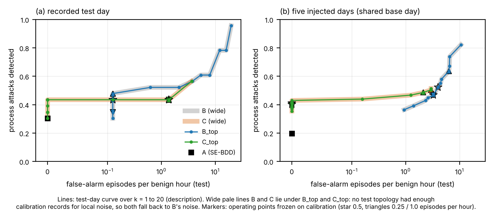

<!-- generated by `python scripts/43_topo_report.py` on 2026-11-21T13:06:49 -->
# Physics floor against per-(channel, topology) noise thresholds, 02-Semiurban: results

Protocol and definitions: `scripts/41_topo_abc.py` (docstring). Calibration frozen before the test in `reports/topo/frozen_P2_recorded.json` and `frozen_P2_split.json` (git commit d321af5). Every day is shown separately; the injected days share one recorded benign half-day and are not independent days. Zero false alarms are written as '0 in X benign hours'.

## 1. Main table, whole test day (waiting for physics rules included)

| day | target (episodes/h) | variant | k (frozen) | detected | per type | false-alarm episodes in benign hours | share of time active | median delay s, B-variant / C-variant (common events) |
| --- | --- | --- | --- | --- | --- | --- | --- | --- |
| recorded day |  | A |  | 7/23 | control-and-freeze 3/5, drift-off 4/9, industroyer 0/9 | 0 in 7.97 h |  |  |
| recorded day | 0.5 | B | 10 | 10/23 | control-and-freeze 4/5, drift-off 6/9, industroyer 0/9 | 1 in 7.97 h (0.13/h) | 97.9 % |  |
| recorded day | 0.5 | C | 1.25 | 10/23 | control-and-freeze 4/5, drift-off 6/9, industroyer 0/9 | 11 in 7.97 h (1.38/h) | 96.1 % | 115 / 102 (10) |
| recorded day | 0.5 | B_top | 10 | 10/23 | control-and-freeze 4/5, drift-off 6/9, industroyer 0/9 | 1 in 7.97 h (0.13/h) | 97.9 % |  |
| recorded day | 0.5 | C_top | 1.25 | 10/23 | control-and-freeze 4/5, drift-off 6/9, industroyer 0/9 | 11 in 7.97 h (1.38/h) | 96.1 % | 115 / 102 (10) |
| recorded day | 0.25 | B | 15 | 8/23 | control-and-freeze 3/5, drift-off 5/9, industroyer 0/9 | 1 in 7.97 h (0.13/h) | 97.9 % |  |
| recorded day | 0.25 | C | 1.25 | 10/23 | control-and-freeze 4/5, drift-off 6/9, industroyer 0/9 | 11 in 7.97 h (1.38/h) | 96.1 % | 125 / 117 (8) |
| recorded day | 0.25 | B_top | 15 | 8/23 | control-and-freeze 3/5, drift-off 5/9, industroyer 0/9 | 1 in 7.97 h (0.13/h) | 97.9 % |  |
| recorded day | 0.25 | C_top | 1.25 | 10/23 | control-and-freeze 4/5, drift-off 6/9, industroyer 0/9 | 11 in 7.97 h (1.38/h) | 96.1 % | 125 / 117 (8) |
| recorded day | 1.0 | B | 7 | 11/23 | control-and-freeze 4/5, drift-off 6/9, industroyer 1/9 | 1 in 7.97 h (0.13/h) | 97.9 % |  |
| recorded day | 1.0 | C | 1.25 | 10/23 | control-and-freeze 4/5, drift-off 6/9, industroyer 0/9 | 11 in 7.97 h (1.38/h) | 96.1 % | 100 / 102 (10) |
| recorded day | 1.0 | B_top | 7 | 11/23 | control-and-freeze 4/5, drift-off 6/9, industroyer 1/9 | 1 in 7.97 h (0.13/h) | 97.9 % |  |
| recorded day | 1.0 | C_top | 1.25 | 10/23 | control-and-freeze 4/5, drift-off 6/9, industroyer 0/9 | 11 in 7.97 h (1.38/h) | 96.1 % | 100 / 102 (10) |
| injected, seed 7 |  | A |  | 2/21 | control-and-freeze 1/7, drift-off 1/7, industroyer 0/7 | 0 in 2.65 h |  |  |
| injected, seed 7 | 0.5 | B | 4 | 12/21 | control-and-freeze 7/7, drift-off 5/7, industroyer 0/7 | 10 in 2.65 h (3.77/h) | 100.0 % |  |
| injected, seed 7 | 0.5 | C | 4 | 10/21 | control-and-freeze 6/7, drift-off 4/7, industroyer 0/7 | 0 in 2.65 h | 97.8 % | 18 / 50 (10) |
| injected, seed 7 | 0.5 | B_top | 5 | 11/21 | control-and-freeze 7/7, drift-off 4/7, industroyer 0/7 | 9 in 2.65 h (3.39/h) | 100.0 % |  |
| injected, seed 7 | 0.5 | C_top | 5 | 10/21 | control-and-freeze 6/7, drift-off 4/7, industroyer 0/7 | 0 in 2.65 h | 97.8 % | 18 / 55 (10) |
| injected, seed 7 | 0.25 | B | 5 | 11/21 | control-and-freeze 7/7, drift-off 4/7, industroyer 0/7 | 9 in 2.65 h (3.39/h) | 100.0 % |  |
| injected, seed 7 | 0.25 | C | 5 | 10/21 | control-and-freeze 6/7, drift-off 4/7, industroyer 0/7 | 0 in 2.65 h | 97.8 % | 18 / 55 (10) |
| injected, seed 7 | 0.25 | B_top | 5 | 11/21 | control-and-freeze 7/7, drift-off 4/7, industroyer 0/7 | 9 in 2.65 h (3.39/h) | 100.0 % |  |
| injected, seed 7 | 0.25 | C_top | 5 | 10/21 | control-and-freeze 6/7, drift-off 4/7, industroyer 0/7 | 0 in 2.65 h | 97.8 % | 18 / 55 (10) |
| injected, seed 7 | 1.0 | B | 2 | 12/21 | control-and-freeze 7/7, drift-off 5/7, industroyer 0/7 | 19 in 2.65 h (7.16/h) | 100.0 % |  |
| injected, seed 7 | 1.0 | C | 1.25 | 11/21 | control-and-freeze 6/7, drift-off 4/7, industroyer 1/7 | 4 in 2.65 h (1.51/h) | 97.8 % | 16 / 27 (10) |
| injected, seed 7 | 1.0 | B_top | 2 | 12/21 | control-and-freeze 7/7, drift-off 5/7, industroyer 0/7 | 19 in 2.65 h (7.16/h) | 100.0 % |  |
| injected, seed 7 | 1.0 | C_top | 1.5 | 10/21 | control-and-freeze 6/7, drift-off 4/7, industroyer 0/7 | 4 in 2.65 h (1.51/h) | 97.8 % | 16 / 27 (10) |
| injected, seed 8 |  | A |  | 3/22 | control-and-freeze 2/7, drift-off 1/8, industroyer 0/7 | 0 in 2.59 h |  |  |
| injected, seed 8 | 0.5 | B | 4 | 11/22 | control-and-freeze 7/7, drift-off 3/8, industroyer 1/7 | 8 in 2.59 h (3.09/h) | 100.0 % |  |
| injected, seed 8 | 0.5 | C | 4 | 6/22 | control-and-freeze 4/7, drift-off 2/8, industroyer 0/7 | 0 in 2.59 h | 98.5 % | 14 / 14 (6) |
| injected, seed 8 | 0.5 | B_top | 5 | 10/22 | control-and-freeze 6/7, drift-off 3/8, industroyer 1/7 | 5 in 2.59 h (1.93/h) | 100.0 % |  |
| injected, seed 8 | 0.5 | C_top | 5 | 6/22 | control-and-freeze 4/7, drift-off 2/8, industroyer 0/7 | 0 in 2.59 h | 98.5 % | 14 / 14 (6) |
| injected, seed 8 | 0.25 | B | 5 | 10/22 | control-and-freeze 6/7, drift-off 3/8, industroyer 1/7 | 5 in 2.59 h (1.93/h) | 100.0 % |  |
| injected, seed 8 | 0.25 | C | 5 | 6/22 | control-and-freeze 4/7, drift-off 2/8, industroyer 0/7 | 0 in 2.59 h | 98.5 % | 14 / 14 (6) |
| injected, seed 8 | 0.25 | B_top | 5 | 10/22 | control-and-freeze 6/7, drift-off 3/8, industroyer 1/7 | 5 in 2.59 h (1.93/h) | 100.0 % |  |
| injected, seed 8 | 0.25 | C_top | 5 | 6/22 | control-and-freeze 4/7, drift-off 2/8, industroyer 0/7 | 0 in 2.59 h | 98.5 % | 14 / 14 (6) |
| injected, seed 8 | 1.0 | B | 2 | 13/22 | control-and-freeze 7/7, drift-off 5/8, industroyer 1/7 | 15 in 2.59 h (5.78/h) | 100.0 % |  |
| injected, seed 8 | 1.0 | C | 1.25 | 8/22 | control-and-freeze 4/7, drift-off 3/8, industroyer 1/7 | 10 in 2.59 h (3.86/h) | 98.5 % | 14 / 14 (8) |
| injected, seed 8 | 1.0 | B_top | 2 | 13/22 | control-and-freeze 7/7, drift-off 5/8, industroyer 1/7 | 15 in 2.59 h (5.78/h) | 100.0 % |  |
| injected, seed 8 | 1.0 | C_top | 1.5 | 7/22 | control-and-freeze 4/7, drift-off 3/8, industroyer 0/7 | 7 in 2.59 h (2.70/h) | 98.5 % | 14 / 14 (7) |
| injected, seed 9 |  | A |  | 4/21 | control-and-freeze 1/7, drift-off 3/7, industroyer 0/7 | 0 in 2.64 h |  |  |
| injected, seed 9 | 0.5 | B | 4 | 11/21 | control-and-freeze 7/7, drift-off 4/7, industroyer 0/7 | 9 in 2.64 h (3.41/h) | 100.0 % |  |
| injected, seed 9 | 0.5 | C | 4 | 10/21 | control-and-freeze 6/7, drift-off 4/7, industroyer 0/7 | 0 in 2.64 h | 98.1 % | 24 / 59 (10) |
| injected, seed 9 | 0.5 | B_top | 5 | 9/21 | control-and-freeze 5/7, drift-off 4/7, industroyer 0/7 | 8 in 2.64 h (3.03/h) | 100.0 % |  |
| injected, seed 9 | 0.5 | C_top | 5 | 9/21 | control-and-freeze 5/7, drift-off 4/7, industroyer 0/7 | 0 in 2.64 h | 98.1 % | 25 / 63 (9) |
| injected, seed 9 | 0.25 | B | 5 | 9/21 | control-and-freeze 5/7, drift-off 4/7, industroyer 0/7 | 8 in 2.64 h (3.03/h) | 100.0 % |  |
| injected, seed 9 | 0.25 | C | 5 | 9/21 | control-and-freeze 5/7, drift-off 4/7, industroyer 0/7 | 0 in 2.64 h | 98.1 % | 25 / 63 (9) |
| injected, seed 9 | 0.25 | B_top | 5 | 9/21 | control-and-freeze 5/7, drift-off 4/7, industroyer 0/7 | 8 in 2.64 h (3.03/h) | 100.0 % |  |
| injected, seed 9 | 0.25 | C_top | 5 | 9/21 | control-and-freeze 5/7, drift-off 4/7, industroyer 0/7 | 0 in 2.64 h | 98.1 % | 25 / 63 (9) |
| injected, seed 9 | 1.0 | B | 2 | 13/21 | control-and-freeze 7/7, drift-off 6/7, industroyer 0/7 | 12 in 2.64 h (4.55/h) | 100.0 % |  |
| injected, seed 9 | 1.0 | C | 1.25 | 11/21 | control-and-freeze 6/7, drift-off 5/7, industroyer 0/7 | 7 in 2.64 h (2.65/h) | 98.1 % | 18 / 40 (11) |
| injected, seed 9 | 1.0 | B_top | 2 | 13/21 | control-and-freeze 7/7, drift-off 6/7, industroyer 0/7 | 12 in 2.64 h (4.55/h) | 100.0 % |  |
| injected, seed 9 | 1.0 | C_top | 1.5 | 11/21 | control-and-freeze 6/7, drift-off 5/7, industroyer 0/7 | 3 in 2.64 h (1.14/h) | 98.1 % | 18 / 50 (11) |
| injected, seed 10 |  | A |  | 7/21 | control-and-freeze 3/7, drift-off 4/7, industroyer 0/7 | 0 in 2.50 h |  |  |
| injected, seed 10 | 0.5 | B | 4 | 12/21 | control-and-freeze 6/7, drift-off 5/7, industroyer 1/7 | 14 in 2.50 h (5.59/h) | 100.0 % |  |
| injected, seed 10 | 0.5 | C | 4 | 10/21 | control-and-freeze 5/7, drift-off 5/7, industroyer 0/7 | 0 in 2.50 h | 97.5 % | 23 / 65 (10) |
| injected, seed 10 | 0.5 | B_top | 5 | 11/21 | control-and-freeze 5/7, drift-off 5/7, industroyer 1/7 | 12 in 2.50 h (4.79/h) | 100.0 % |  |
| injected, seed 10 | 0.5 | C_top | 5 | 10/21 | control-and-freeze 5/7, drift-off 5/7, industroyer 0/7 | 0 in 2.50 h | 97.5 % | 23 / 65 (10) |
| injected, seed 10 | 0.25 | B | 5 | 11/21 | control-and-freeze 5/7, drift-off 5/7, industroyer 1/7 | 12 in 2.50 h (4.79/h) | 100.0 % |  |
| injected, seed 10 | 0.25 | C | 5 | 10/21 | control-and-freeze 5/7, drift-off 5/7, industroyer 0/7 | 0 in 2.50 h | 97.5 % | 23 / 65 (10) |
| injected, seed 10 | 0.25 | B_top | 5 | 11/21 | control-and-freeze 5/7, drift-off 5/7, industroyer 1/7 | 12 in 2.50 h (4.79/h) | 100.0 % |  |
| injected, seed 10 | 0.25 | C_top | 5 | 10/21 | control-and-freeze 5/7, drift-off 5/7, industroyer 0/7 | 0 in 2.50 h | 97.5 % | 23 / 65 (10) |
| injected, seed 10 | 1.0 | B | 2 | 15/21 | control-and-freeze 7/7, drift-off 6/7, industroyer 2/7 | 20 in 2.50 h (7.99/h) | 100.0 % |  |
| injected, seed 10 | 1.0 | C | 1.25 | 14/21 | control-and-freeze 7/7, drift-off 6/7, industroyer 1/7 | 8 in 2.50 h (3.19/h) | 97.5 % | 29 / 76 (14) |
| injected, seed 10 | 1.0 | B_top | 2 | 15/21 | control-and-freeze 7/7, drift-off 6/7, industroyer 2/7 | 20 in 2.50 h (7.99/h) | 100.0 % |  |
| injected, seed 10 | 1.0 | C_top | 1.5 | 14/21 | control-and-freeze 7/7, drift-off 6/7, industroyer 1/7 | 7 in 2.50 h (2.80/h) | 97.5 % | 29 / 81 (14) |
| injected, seed 11 |  | A |  | 5/22 | control-and-freeze 2/8, drift-off 3/7, industroyer 0/7 | 0 in 2.42 h |  |  |
| injected, seed 11 | 0.5 | B | 4 | 10/22 | control-and-freeze 6/8, drift-off 3/7, industroyer 1/7 | 10 in 2.42 h (4.12/h) | 100.0 % |  |
| injected, seed 11 | 0.5 | C | 4 | 8/22 | control-and-freeze 5/8, drift-off 3/7, industroyer 0/7 | 0 in 2.42 h | 98.4 % | 32 / 66 (8) |
| injected, seed 11 | 0.5 | B_top | 5 | 9/22 | control-and-freeze 5/8, drift-off 3/7, industroyer 1/7 | 8 in 2.42 h (3.30/h) | 100.0 % |  |
| injected, seed 11 | 0.5 | C_top | 5 | 8/22 | control-and-freeze 5/8, drift-off 3/7, industroyer 0/7 | 0 in 2.42 h | 98.4 % | 34 / 80 (8) |
| injected, seed 11 | 0.25 | B | 5 | 9/22 | control-and-freeze 5/8, drift-off 3/7, industroyer 1/7 | 8 in 2.42 h (3.30/h) | 100.0 % |  |
| injected, seed 11 | 0.25 | C | 5 | 8/22 | control-and-freeze 5/8, drift-off 3/7, industroyer 0/7 | 0 in 2.42 h | 98.4 % | 34 / 80 (8) |
| injected, seed 11 | 0.25 | B_top | 5 | 9/22 | control-and-freeze 5/8, drift-off 3/7, industroyer 1/7 | 8 in 2.42 h (3.30/h) | 100.0 % |  |
| injected, seed 11 | 0.25 | C_top | 5 | 8/22 | control-and-freeze 5/8, drift-off 3/7, industroyer 0/7 | 0 in 2.42 h | 98.4 % | 34 / 80 (8) |
| injected, seed 11 | 1.0 | B | 2 | 15/22 | control-and-freeze 8/8, drift-off 5/7, industroyer 2/7 | 15 in 2.42 h (6.19/h) | 100.0 % |  |
| injected, seed 11 | 1.0 | C | 1.25 | 10/22 | control-and-freeze 5/8, drift-off 4/7, industroyer 1/7 | 9 in 2.42 h (3.71/h) | 98.4 % | 22 / 42 (9) |
| injected, seed 11 | 1.0 | B_top | 2 | 15/22 | control-and-freeze 8/8, drift-off 5/7, industroyer 2/7 | 15 in 2.42 h (6.19/h) | 100.0 % |  |
| injected, seed 11 | 1.0 | C_top | 1.5 | 10/22 | control-and-freeze 5/8, drift-off 4/7, industroyer 1/7 | 6 in 2.42 h (2.47/h) | 98.4 % | 22 / 71 (9) |

## 2. Same, restricted to records where the physics rule of the record's topology is active (both methods active)

| day | target (episodes/h) | variant | k (frozen) | detected | per type | false-alarm episodes in benign hours | share of time active | median delay s, B-variant / C-variant (common events) |
| --- | --- | --- | --- | --- | --- | --- | --- | --- |
| recorded day |  | A |  | 7/23 | control-and-freeze 3/5, drift-off 4/9, industroyer 0/9 | 0 in 7.76 h |  |  |
| recorded day | 0.5 | B | 10 | 10/23 | control-and-freeze 4/5, drift-off 6/9, industroyer 0/9 | 0 in 7.76 h | 97.9 % |  |
| recorded day | 0.5 | C | 1.25 | 10/23 | control-and-freeze 4/5, drift-off 6/9, industroyer 0/9 | 11 in 7.76 h (1.42/h) | 96.1 % | 115 / 102 (10) |
| recorded day | 0.5 | B_top | 10 | 10/23 | control-and-freeze 4/5, drift-off 6/9, industroyer 0/9 | 0 in 7.76 h | 97.9 % |  |
| recorded day | 0.5 | C_top | 1.25 | 10/23 | control-and-freeze 4/5, drift-off 6/9, industroyer 0/9 | 11 in 7.76 h (1.42/h) | 96.1 % | 115 / 102 (10) |
| recorded day | 0.25 | B | 15 | 8/23 | control-and-freeze 3/5, drift-off 5/9, industroyer 0/9 | 0 in 7.76 h | 97.9 % |  |
| recorded day | 0.25 | C | 1.25 | 10/23 | control-and-freeze 4/5, drift-off 6/9, industroyer 0/9 | 11 in 7.76 h (1.42/h) | 96.1 % | 125 / 117 (8) |
| recorded day | 0.25 | B_top | 15 | 8/23 | control-and-freeze 3/5, drift-off 5/9, industroyer 0/9 | 0 in 7.76 h | 97.9 % |  |
| recorded day | 0.25 | C_top | 1.25 | 10/23 | control-and-freeze 4/5, drift-off 6/9, industroyer 0/9 | 11 in 7.76 h (1.42/h) | 96.1 % | 125 / 117 (8) |
| recorded day | 1.0 | B | 7 | 10/23 | control-and-freeze 4/5, drift-off 6/9, industroyer 0/9 | 0 in 7.76 h | 97.9 % |  |
| recorded day | 1.0 | C | 1.25 | 10/23 | control-and-freeze 4/5, drift-off 6/9, industroyer 0/9 | 11 in 7.76 h (1.42/h) | 96.1 % | 100 / 102 (10) |
| recorded day | 1.0 | B_top | 7 | 10/23 | control-and-freeze 4/5, drift-off 6/9, industroyer 0/9 | 0 in 7.76 h | 97.9 % |  |
| recorded day | 1.0 | C_top | 1.25 | 10/23 | control-and-freeze 4/5, drift-off 6/9, industroyer 0/9 | 11 in 7.76 h (1.42/h) | 96.1 % | 100 / 102 (10) |
| injected, seed 7 |  | A |  | 2/21 | control-and-freeze 1/7, drift-off 1/7, industroyer 0/7 | 0 in 2.61 h |  |  |
| injected, seed 7 | 0.5 | B | 4 | 12/21 | control-and-freeze 7/7, drift-off 5/7, industroyer 0/7 | 9 in 2.61 h (3.45/h) | 100.0 % |  |
| injected, seed 7 | 0.5 | C | 4 | 10/21 | control-and-freeze 6/7, drift-off 4/7, industroyer 0/7 | 0 in 2.61 h | 97.8 % | 18 / 50 (10) |
| injected, seed 7 | 0.5 | B_top | 5 | 11/21 | control-and-freeze 7/7, drift-off 4/7, industroyer 0/7 | 8 in 2.61 h (3.07/h) | 100.0 % |  |
| injected, seed 7 | 0.5 | C_top | 5 | 10/21 | control-and-freeze 6/7, drift-off 4/7, industroyer 0/7 | 0 in 2.61 h | 97.8 % | 18 / 55 (10) |
| injected, seed 7 | 0.25 | B | 5 | 11/21 | control-and-freeze 7/7, drift-off 4/7, industroyer 0/7 | 8 in 2.61 h (3.07/h) | 100.0 % |  |
| injected, seed 7 | 0.25 | C | 5 | 10/21 | control-and-freeze 6/7, drift-off 4/7, industroyer 0/7 | 0 in 2.61 h | 97.8 % | 18 / 55 (10) |
| injected, seed 7 | 0.25 | B_top | 5 | 11/21 | control-and-freeze 7/7, drift-off 4/7, industroyer 0/7 | 8 in 2.61 h (3.07/h) | 100.0 % |  |
| injected, seed 7 | 0.25 | C_top | 5 | 10/21 | control-and-freeze 6/7, drift-off 4/7, industroyer 0/7 | 0 in 2.61 h | 97.8 % | 18 / 55 (10) |
| injected, seed 7 | 1.0 | B | 2 | 12/21 | control-and-freeze 7/7, drift-off 5/7, industroyer 0/7 | 18 in 2.61 h (6.90/h) | 100.0 % |  |
| injected, seed 7 | 1.0 | C | 1.25 | 11/21 | control-and-freeze 6/7, drift-off 4/7, industroyer 1/7 | 4 in 2.61 h (1.53/h) | 97.8 % | 16 / 27 (10) |
| injected, seed 7 | 1.0 | B_top | 2 | 12/21 | control-and-freeze 7/7, drift-off 5/7, industroyer 0/7 | 18 in 2.61 h (6.90/h) | 100.0 % |  |
| injected, seed 7 | 1.0 | C_top | 1.5 | 10/21 | control-and-freeze 6/7, drift-off 4/7, industroyer 0/7 | 4 in 2.61 h (1.53/h) | 97.8 % | 16 / 27 (10) |
| injected, seed 8 |  | A |  | 3/22 | control-and-freeze 2/7, drift-off 1/8, industroyer 0/7 | 0 in 2.55 h |  |  |
| injected, seed 8 | 0.5 | B | 4 | 11/22 | control-and-freeze 7/7, drift-off 3/8, industroyer 1/7 | 7 in 2.55 h (2.75/h) | 100.0 % |  |
| injected, seed 8 | 0.5 | C | 4 | 6/22 | control-and-freeze 4/7, drift-off 2/8, industroyer 0/7 | 0 in 2.55 h | 98.5 % | 14 / 14 (6) |
| injected, seed 8 | 0.5 | B_top | 5 | 10/22 | control-and-freeze 6/7, drift-off 3/8, industroyer 1/7 | 4 in 2.55 h (1.57/h) | 100.0 % |  |
| injected, seed 8 | 0.5 | C_top | 5 | 6/22 | control-and-freeze 4/7, drift-off 2/8, industroyer 0/7 | 0 in 2.55 h | 98.5 % | 14 / 14 (6) |
| injected, seed 8 | 0.25 | B | 5 | 10/22 | control-and-freeze 6/7, drift-off 3/8, industroyer 1/7 | 4 in 2.55 h (1.57/h) | 100.0 % |  |
| injected, seed 8 | 0.25 | C | 5 | 6/22 | control-and-freeze 4/7, drift-off 2/8, industroyer 0/7 | 0 in 2.55 h | 98.5 % | 14 / 14 (6) |
| injected, seed 8 | 0.25 | B_top | 5 | 10/22 | control-and-freeze 6/7, drift-off 3/8, industroyer 1/7 | 4 in 2.55 h (1.57/h) | 100.0 % |  |
| injected, seed 8 | 0.25 | C_top | 5 | 6/22 | control-and-freeze 4/7, drift-off 2/8, industroyer 0/7 | 0 in 2.55 h | 98.5 % | 14 / 14 (6) |
| injected, seed 8 | 1.0 | B | 2 | 13/22 | control-and-freeze 7/7, drift-off 5/8, industroyer 1/7 | 14 in 2.55 h (5.50/h) | 100.0 % |  |
| injected, seed 8 | 1.0 | C | 1.25 | 8/22 | control-and-freeze 4/7, drift-off 3/8, industroyer 1/7 | 10 in 2.55 h (3.93/h) | 98.5 % | 14 / 14 (8) |
| injected, seed 8 | 1.0 | B_top | 2 | 13/22 | control-and-freeze 7/7, drift-off 5/8, industroyer 1/7 | 14 in 2.55 h (5.50/h) | 100.0 % |  |
| injected, seed 8 | 1.0 | C_top | 1.5 | 7/22 | control-and-freeze 4/7, drift-off 3/8, industroyer 0/7 | 7 in 2.55 h (2.75/h) | 98.5 % | 14 / 14 (7) |
| injected, seed 9 |  | A |  | 4/21 | control-and-freeze 1/7, drift-off 3/7, industroyer 0/7 | 0 in 2.59 h |  |  |
| injected, seed 9 | 0.5 | B | 4 | 11/21 | control-and-freeze 7/7, drift-off 4/7, industroyer 0/7 | 8 in 2.59 h (3.09/h) | 100.0 % |  |
| injected, seed 9 | 0.5 | C | 4 | 10/21 | control-and-freeze 6/7, drift-off 4/7, industroyer 0/7 | 0 in 2.59 h | 98.1 % | 24 / 59 (10) |
| injected, seed 9 | 0.5 | B_top | 5 | 9/21 | control-and-freeze 5/7, drift-off 4/7, industroyer 0/7 | 7 in 2.59 h (2.71/h) | 100.0 % |  |
| injected, seed 9 | 0.5 | C_top | 5 | 9/21 | control-and-freeze 5/7, drift-off 4/7, industroyer 0/7 | 0 in 2.59 h | 98.1 % | 25 / 63 (9) |
| injected, seed 9 | 0.25 | B | 5 | 9/21 | control-and-freeze 5/7, drift-off 4/7, industroyer 0/7 | 7 in 2.59 h (2.71/h) | 100.0 % |  |
| injected, seed 9 | 0.25 | C | 5 | 9/21 | control-and-freeze 5/7, drift-off 4/7, industroyer 0/7 | 0 in 2.59 h | 98.1 % | 25 / 63 (9) |
| injected, seed 9 | 0.25 | B_top | 5 | 9/21 | control-and-freeze 5/7, drift-off 4/7, industroyer 0/7 | 7 in 2.59 h (2.71/h) | 100.0 % |  |
| injected, seed 9 | 0.25 | C_top | 5 | 9/21 | control-and-freeze 5/7, drift-off 4/7, industroyer 0/7 | 0 in 2.59 h | 98.1 % | 25 / 63 (9) |
| injected, seed 9 | 1.0 | B | 2 | 13/21 | control-and-freeze 7/7, drift-off 6/7, industroyer 0/7 | 11 in 2.59 h (4.25/h) | 100.0 % |  |
| injected, seed 9 | 1.0 | C | 1.25 | 11/21 | control-and-freeze 6/7, drift-off 5/7, industroyer 0/7 | 7 in 2.59 h (2.71/h) | 98.1 % | 18 / 40 (11) |
| injected, seed 9 | 1.0 | B_top | 2 | 13/21 | control-and-freeze 7/7, drift-off 6/7, industroyer 0/7 | 11 in 2.59 h (4.25/h) | 100.0 % |  |
| injected, seed 9 | 1.0 | C_top | 1.5 | 11/21 | control-and-freeze 6/7, drift-off 5/7, industroyer 0/7 | 3 in 2.59 h (1.16/h) | 98.1 % | 18 / 50 (11) |
| injected, seed 10 |  | A |  | 7/21 | control-and-freeze 3/7, drift-off 4/7, industroyer 0/7 | 0 in 2.46 h |  |  |
| injected, seed 10 | 0.5 | B | 4 | 12/21 | control-and-freeze 6/7, drift-off 5/7, industroyer 1/7 | 13 in 2.46 h (5.28/h) | 100.0 % |  |
| injected, seed 10 | 0.5 | C | 4 | 10/21 | control-and-freeze 5/7, drift-off 5/7, industroyer 0/7 | 0 in 2.46 h | 97.5 % | 23 / 65 (10) |
| injected, seed 10 | 0.5 | B_top | 5 | 11/21 | control-and-freeze 5/7, drift-off 5/7, industroyer 1/7 | 11 in 2.46 h (4.47/h) | 100.0 % |  |
| injected, seed 10 | 0.5 | C_top | 5 | 10/21 | control-and-freeze 5/7, drift-off 5/7, industroyer 0/7 | 0 in 2.46 h | 97.5 % | 23 / 65 (10) |
| injected, seed 10 | 0.25 | B | 5 | 11/21 | control-and-freeze 5/7, drift-off 5/7, industroyer 1/7 | 11 in 2.46 h (4.47/h) | 100.0 % |  |
| injected, seed 10 | 0.25 | C | 5 | 10/21 | control-and-freeze 5/7, drift-off 5/7, industroyer 0/7 | 0 in 2.46 h | 97.5 % | 23 / 65 (10) |
| injected, seed 10 | 0.25 | B_top | 5 | 11/21 | control-and-freeze 5/7, drift-off 5/7, industroyer 1/7 | 11 in 2.46 h (4.47/h) | 100.0 % |  |
| injected, seed 10 | 0.25 | C_top | 5 | 10/21 | control-and-freeze 5/7, drift-off 5/7, industroyer 0/7 | 0 in 2.46 h | 97.5 % | 23 / 65 (10) |
| injected, seed 10 | 1.0 | B | 2 | 15/21 | control-and-freeze 7/7, drift-off 6/7, industroyer 2/7 | 19 in 2.46 h (7.72/h) | 100.0 % |  |
| injected, seed 10 | 1.0 | C | 1.25 | 14/21 | control-and-freeze 7/7, drift-off 6/7, industroyer 1/7 | 8 in 2.46 h (3.25/h) | 97.5 % | 29 / 76 (14) |
| injected, seed 10 | 1.0 | B_top | 2 | 15/21 | control-and-freeze 7/7, drift-off 6/7, industroyer 2/7 | 19 in 2.46 h (7.72/h) | 100.0 % |  |
| injected, seed 10 | 1.0 | C_top | 1.5 | 14/21 | control-and-freeze 7/7, drift-off 6/7, industroyer 1/7 | 7 in 2.46 h (2.84/h) | 97.5 % | 29 / 81 (14) |
| injected, seed 11 |  | A |  | 5/22 | control-and-freeze 2/8, drift-off 3/7, industroyer 0/7 | 0 in 2.38 h |  |  |
| injected, seed 11 | 0.5 | B | 4 | 10/22 | control-and-freeze 6/8, drift-off 3/7, industroyer 1/7 | 9 in 2.38 h (3.78/h) | 100.0 % |  |
| injected, seed 11 | 0.5 | C | 4 | 8/22 | control-and-freeze 5/8, drift-off 3/7, industroyer 0/7 | 0 in 2.38 h | 98.4 % | 32 / 66 (8) |
| injected, seed 11 | 0.5 | B_top | 5 | 9/22 | control-and-freeze 5/8, drift-off 3/7, industroyer 1/7 | 7 in 2.38 h (2.94/h) | 100.0 % |  |
| injected, seed 11 | 0.5 | C_top | 5 | 8/22 | control-and-freeze 5/8, drift-off 3/7, industroyer 0/7 | 0 in 2.38 h | 98.4 % | 34 / 80 (8) |
| injected, seed 11 | 0.25 | B | 5 | 9/22 | control-and-freeze 5/8, drift-off 3/7, industroyer 1/7 | 7 in 2.38 h (2.94/h) | 100.0 % |  |
| injected, seed 11 | 0.25 | C | 5 | 8/22 | control-and-freeze 5/8, drift-off 3/7, industroyer 0/7 | 0 in 2.38 h | 98.4 % | 34 / 80 (8) |
| injected, seed 11 | 0.25 | B_top | 5 | 9/22 | control-and-freeze 5/8, drift-off 3/7, industroyer 1/7 | 7 in 2.38 h (2.94/h) | 100.0 % |  |
| injected, seed 11 | 0.25 | C_top | 5 | 8/22 | control-and-freeze 5/8, drift-off 3/7, industroyer 0/7 | 0 in 2.38 h | 98.4 % | 34 / 80 (8) |
| injected, seed 11 | 1.0 | B | 2 | 15/22 | control-and-freeze 8/8, drift-off 5/7, industroyer 2/7 | 14 in 2.38 h (5.87/h) | 100.0 % |  |
| injected, seed 11 | 1.0 | C | 1.25 | 10/22 | control-and-freeze 5/8, drift-off 4/7, industroyer 1/7 | 9 in 2.38 h (3.78/h) | 98.4 % | 22 / 42 (9) |
| injected, seed 11 | 1.0 | B_top | 2 | 15/22 | control-and-freeze 8/8, drift-off 5/7, industroyer 2/7 | 14 in 2.38 h (5.87/h) | 100.0 % |  |
| injected, seed 11 | 1.0 | C_top | 1.5 | 10/22 | control-and-freeze 5/8, drift-off 4/7, industroyer 1/7 | 6 in 2.38 h (2.52/h) | 98.4 % | 22 / 71 (9) |

## 3. Five injected days together, target 0.5 (descriptive; one shared benign base day)

| variant | detected | false-alarm episodes |
| --- | --- | --- |
| A | 21/107 | 0 in 12.8 h (0.00/h) |
| B | 56/107 | 51 in 12.8 h (3.98/h) |
| C | 44/107 | 0 in 12.8 h (0.00/h) |
| B_top | 50/107 | 42 in 12.8 h (3.28/h) |
| C_top | 43/107 | 0 in 12.8 h (0.00/h) |

## 4. Paired comparisons (whole test day)

| day | target | comparison | only first | ids | only second | ids | both | median delay first | median delay second |
| --- | --- | --- | --- | --- | --- | --- | --- | --- | --- |
| recorded day | 0.5 | B_top vs C_top | 0 |  | 0 |  | 10 | 115 | 102 |
| recorded day | 0.5 | B vs C | 0 |  | 0 |  | 10 | 115 | 102 |
| recorded day | 0.5 | A vs B_top | 0 |  | 3 | 7,8,32 | 7 | 288 | 112 |
| recorded day | 0.25 | B_top vs C_top | 0 |  | 2 | 18,32 | 8 | 125 | 117 |
| recorded day | 0.25 | B vs C | 0 |  | 2 | 18,32 | 8 | 125 | 117 |
| recorded day | 0.25 | A vs B_top | 1 | 18 | 2 | 7,8 | 6 | 292 | 125 |
| recorded day | 1.0 | B_top vs C_top | 1 | 30 | 0 |  | 10 | 100 | 102 |
| recorded day | 1.0 | B vs C | 1 | 30 | 0 |  | 10 | 100 | 102 |
| recorded day | 1.0 | A vs B_top | 0 |  | 4 | 7,8,30,32 | 7 | 288 | 98 |
| injected, seed 7 | 0.5 | B_top vs C_top | 1 | 12 | 0 |  | 10 | 18 | 55 |
| injected, seed 7 | 0.5 | B vs C | 2 | 2,12 | 0 |  | 10 | 18 | 50 |
| injected, seed 7 | 0.5 | A vs B_top | 0 |  | 9 | 1,4,7,9,12,13,15,17,20 | 2 | 60 | 18 |
| injected, seed 7 | 0.25 | B_top vs C_top | 1 | 12 | 0 |  | 10 | 18 | 55 |
| injected, seed 7 | 0.25 | B vs C | 1 | 12 | 0 |  | 10 | 18 | 55 |
| injected, seed 7 | 0.25 | A vs B_top | 0 |  | 9 | 1,4,7,9,12,13,15,17,20 | 2 | 60 | 18 |
| injected, seed 7 | 1.0 | B_top vs C_top | 2 | 2,12 | 0 |  | 10 | 16 | 27 |
| injected, seed 7 | 1.0 | B vs C | 2 | 2,12 | 1 | 19 | 10 | 16 | 27 |
| injected, seed 7 | 1.0 | A vs B_top | 0 |  | 10 | 1,2,4,7,9,12,13,15,17,20 | 2 | 60 | 15 |
| injected, seed 8 | 0.5 | B_top vs C_top | 4 | 2,3,10,18 | 0 |  | 6 | 14 | 14 |
| injected, seed 8 | 0.5 | B vs C | 5 | 2,3,5,10,18 | 0 |  | 6 | 14 | 14 |
| injected, seed 8 | 0.5 | A vs B_top | 0 |  | 7 | 0,1,2,3,8,10,18 | 3 | 14 | 14 |
| injected, seed 8 | 0.25 | B_top vs C_top | 4 | 2,3,10,18 | 0 |  | 6 | 14 | 14 |
| injected, seed 8 | 0.25 | B vs C | 4 | 2,3,10,18 | 0 |  | 6 | 14 | 14 |
| injected, seed 8 | 0.25 | A vs B_top | 0 |  | 7 | 0,1,2,3,8,10,18 | 3 | 14 | 14 |
| injected, seed 8 | 1.0 | B_top vs C_top | 6 | 2,3,5,10,18,20 | 0 |  | 7 | 14 | 14 |
| injected, seed 8 | 1.0 | B vs C | 5 | 3,5,10,18,20 | 0 |  | 8 | 14 | 14 |
| injected, seed 8 | 1.0 | A vs B_top | 0 |  | 10 | 0,1,2,3,5,8,10,18,20,21 | 3 | 14 | 14 |
| injected, seed 9 | 0.5 | B_top vs C_top | 0 |  | 0 |  | 9 | 25 | 63 |
| injected, seed 9 | 0.5 | B vs C | 1 | 4 | 0 |  | 10 | 24 | 59 |
| injected, seed 9 | 0.5 | A vs B_top | 0 |  | 5 | 1,5,10,12,15 | 4 | 172 | 29 |
| injected, seed 9 | 0.25 | B_top vs C_top | 0 |  | 0 |  | 9 | 25 | 63 |
| injected, seed 9 | 0.25 | B vs C | 0 |  | 0 |  | 9 | 25 | 63 |
| injected, seed 9 | 0.25 | A vs B_top | 0 |  | 5 | 1,5,10,12,15 | 4 | 172 | 29 |
| injected, seed 9 | 1.0 | B_top vs C_top | 2 | 4,9 | 0 |  | 11 | 18 | 50 |
| injected, seed 9 | 1.0 | B vs C | 2 | 4,9 | 0 |  | 11 | 18 | 40 |
| injected, seed 9 | 1.0 | A vs B_top | 0 |  | 9 | 1,4,5,8,9,10,12,15,20 | 4 | 172 | 15 |
| injected, seed 10 | 0.5 | B_top vs C_top | 1 | 1 | 0 |  | 10 | 23 | 65 |
| injected, seed 10 | 0.5 | B vs C | 2 | 0,1 | 0 |  | 10 | 23 | 65 |
| injected, seed 10 | 0.5 | A vs B_top | 0 |  | 4 | 1,2,4,19 | 7 | 106 | 21 |
| injected, seed 10 | 0.25 | B_top vs C_top | 1 | 1 | 0 |  | 10 | 23 | 65 |
| injected, seed 10 | 0.25 | B vs C | 1 | 1 | 0 |  | 10 | 23 | 65 |
| injected, seed 10 | 0.25 | A vs B_top | 0 |  | 4 | 1,2,4,19 | 7 | 106 | 21 |
| injected, seed 10 | 1.0 | B_top vs C_top | 1 | 1 | 0 |  | 14 | 29 | 81 |
| injected, seed 10 | 1.0 | B vs C | 1 | 1 | 0 |  | 14 | 29 | 76 |
| injected, seed 10 | 1.0 | A vs B_top | 0 |  | 8 | 0,1,2,4,6,8,11,19 | 7 | 106 | 16 |
| injected, seed 11 | 0.5 | B_top vs C_top | 1 | 3 | 0 |  | 8 | 34 | 80 |
| injected, seed 11 | 0.5 | B vs C | 2 | 0,3 | 0 |  | 8 | 32 | 66 |
| injected, seed 11 | 0.5 | A vs B_top | 0 |  | 4 | 3,4,15,21 | 5 | 266 | 13 |
| injected, seed 11 | 0.25 | B_top vs C_top | 1 | 3 | 0 |  | 8 | 34 | 80 |
| injected, seed 11 | 0.25 | B vs C | 1 | 3 | 0 |  | 8 | 34 | 80 |
| injected, seed 11 | 0.25 | A vs B_top | 0 |  | 4 | 3,4,15,21 | 5 | 266 | 13 |
| injected, seed 11 | 1.0 | B_top vs C_top | 6 | 0,2,3,12,19,20 | 1 | 18 | 9 | 22 | 71 |
| injected, seed 11 | 1.0 | B vs C | 6 | 0,2,3,12,19,20 | 1 | 18 | 9 | 22 | 42 |
| injected, seed 11 | 1.0 | A vs B_top | 0 |  | 10 | 0,2,3,4,12,14,15,19,20,21 | 5 | 266 | 13 |

## 5. Instances detected by only one method (target 0.5): topology, channel, residual, both thresholds, alarm time

| day | comparison | detected only by | event | type | topology | topology class | channel | |r| (sigma) | threshold of first method | threshold of second method | first alarm s after start | why the second method missed |
| --- | --- | --- | --- | --- | --- | --- | --- | --- | --- | --- | --- | --- |
| injected, seed 7 | B_top vs C_top | B_top | 12 | control-and-freeze | ties=none;out=L21+L71+L80+L113+L114+L115+L119+L120 | new in test | vm_pu.23 | 14.722 | 14.703 | 38.316 | 322 | physics floor above residual |
| injected, seed 7 | B vs C | B | 2 | drift-off | ties=none;out=L21+L71+L113+L114+L115+L119+L120 | new in test | load_p.73 | 0.095 | 0.084 | 13.745 | 290 | physics floor above residual |
| injected, seed 7 | B vs C | B | 12 | control-and-freeze | ties=none;out=L21+L71+L80+L113+L114+L115+L119+L120 | new in test | vm_pu.23 | 13.427 | 11.762 | 38.316 | 292 | physics floor above residual |
| injected, seed 8 | B_top vs C_top | B_top | 2 | industroyer | ties=none;out=L21+L71+L113+L114+L115+L119+L120 | new in test | load_p.73 | 0.450 | 0.105 | 13.750 | 4 | physics floor above residual |
| injected, seed 8 | B_top vs C_top | B_top | 3 | drift-off | ties=none;out=L21+L71+L113+L114+L115+L119+L120 | new in test | load_p.73 | 0.234 | 0.105 | 13.750 | 40 | physics floor above residual |
| injected, seed 8 | B_top vs C_top | B_top | 10 | control-and-freeze | ties=none;out=L21+L71+L80+L113+L114+L115+L119+L120 | new in test | vm_pu.56 | 12.669 | 11.035 | 37.397 | 235 | physics floor above residual |
| injected, seed 8 | B_top vs C_top | B_top | 18 | control-and-freeze | ties=none;out=L21+L71+L80+L113+L114+L115+L119+L120 | new in test | load_p.28 | 0.068 | 0.059 | 0.424 | 265 | physics floor above residual |
| injected, seed 8 | B vs C | B | 2 | industroyer | ties=none;out=L21+L71+L113+L114+L115+L119+L120 | new in test | load_p.73 | 0.450 | 0.084 | 13.750 | 4 | physics floor above residual |
| injected, seed 8 | B vs C | B | 3 | drift-off | ties=none;out=L21+L71+L113+L114+L115+L119+L120 | new in test | load_p.73 | 0.234 | 0.084 | 13.750 | 40 | physics floor above residual |
| injected, seed 8 | B vs C | B | 5 | control-and-freeze | ties=none;out=L21+L71+L80+L113+L114+L115+L119+L120 | new in test | vm_pu.143 | 9.160 | 8.828 | 39.490 | 295 | physics floor above residual |
| injected, seed 8 | B vs C | B | 10 | control-and-freeze | ties=none;out=L21+L71+L80+L113+L114+L115+L119+L120 | new in test | vm_pu.56 | 10.264 | 8.828 | 37.397 | 215 | physics floor above residual |
| injected, seed 8 | B vs C | B | 18 | control-and-freeze | ties=none;out=L21+L71+L80+L113+L114+L115+L119+L120 | new in test | load_p.28 | 0.058 | 0.047 | 0.424 | 250 | physics floor above residual |
| injected, seed 9 | B vs C | B | 4 | control-and-freeze | ties=none;out=L21+L71+L80+L113+L114+L115+L119+L120 | new in test | vm_pu.163 | 9.798 | 8.828 | 36.735 | 215 | physics floor above residual |
| injected, seed 10 | B_top vs C_top | B_top | 1 | industroyer | ties=none;out=L21+L71+L109+L113+L114+L115+L119+L120 | new in test | load_p.73 | 0.515 | 0.105 | 13.849 | 5 | waiting for physics rule |
| injected, seed 10 | B vs C | B | 0 | control-and-freeze | ties=none;out=L21+L71+L113+L114+L115+L116+L119+L120 | seen in calibration | vm_pu.153 | 9.137 | 8.828 | 37.198 | 350 | physics floor above residual |
| injected, seed 10 | B vs C | B | 1 | industroyer | ties=none;out=L21+L71+L109+L113+L114+L115+L119+L120 | new in test | load_p.73 | 0.515 | 0.084 | 13.849 | 5 | waiting for physics rule |
| injected, seed 11 | B_top vs C_top | B_top | 3 | industroyer | ties=none;out=L21+L71+L113+L114+L115+L119+L120 | new in test | load_p.73 | 0.689 | 0.105 | 13.750 | 4 | physics floor above residual |
| injected, seed 11 | B vs C | B | 0 | control-and-freeze | ties=none;out=L21+L71+L113+L114+L115+L116+L119+L120 | seen in calibration | vm_pu.145 | 9.280 | 8.974 | 39.692 | 360 | physics floor above residual |
| injected, seed 11 | B vs C | B | 3 | industroyer | ties=none;out=L21+L71+L113+L114+L115+L119+L120 | new in test | load_p.73 | 0.689 | 0.084 | 13.750 | 4 | physics floor above residual |

## 6. Events and false alarms by topology class (target 0.5)

| day | variant | topology class | detected | false-alarm episodes | benign hours |
| --- | --- | --- | --- | --- | --- |
| recorded day | A | seen in calibration | 0/1 | 0 | 1.28 |
| recorded day | A | new in test | 7/22 | 0 | 6.59 |
| recorded day | B | seen in calibration | 0/1 | 0 | 1.28 |
| recorded day | B | new in test | 10/22 | 1 | 6.59 |
| recorded day | C | seen in calibration | 0/1 | 3 | 1.28 |
| recorded day | C | new in test | 10/22 | 8 | 6.59 |
| recorded day | B_top | seen in calibration | 0/1 | 0 | 1.28 |
| recorded day | B_top | new in test | 10/22 | 1 | 6.59 |
| recorded day | C_top | seen in calibration | 0/1 | 3 | 1.28 |
| recorded day | C_top | new in test | 10/22 | 8 | 6.59 |
| injected, seed 7 | A | seen in calibration | 0/0 | 0 | 0.46 |
| injected, seed 7 | A | new in test | 2/21 | 0 | 2.19 |
| injected, seed 7 | B | seen in calibration | 0/0 | 0 | 0.46 |
| injected, seed 7 | B | new in test | 12/21 | 10 | 2.19 |
| injected, seed 7 | C | seen in calibration | 0/0 | 0 | 0.46 |
| injected, seed 7 | C | new in test | 10/21 | 0 | 2.19 |
| injected, seed 7 | B_top | seen in calibration | 0/0 | 0 | 0.46 |
| injected, seed 7 | B_top | new in test | 11/21 | 9 | 2.19 |
| injected, seed 7 | C_top | seen in calibration | 0/0 | 0 | 0.46 |
| injected, seed 7 | C_top | new in test | 10/21 | 0 | 2.19 |
| injected, seed 8 | A | seen in calibration | 0/1 | 0 | 0.37 |
| injected, seed 8 | A | new in test | 3/21 | 0 | 2.23 |
| injected, seed 8 | B | seen in calibration | 1/1 | 0 | 0.37 |
| injected, seed 8 | B | new in test | 10/21 | 8 | 2.23 |
| injected, seed 8 | C | seen in calibration | 1/1 | 0 | 0.37 |
| injected, seed 8 | C | new in test | 5/21 | 0 | 2.23 |
| injected, seed 8 | B_top | seen in calibration | 1/1 | 0 | 0.37 |
| injected, seed 8 | B_top | new in test | 9/21 | 5 | 2.23 |
| injected, seed 8 | C_top | seen in calibration | 1/1 | 0 | 0.37 |
| injected, seed 8 | C_top | new in test | 5/21 | 0 | 2.23 |
| injected, seed 9 | A | seen in calibration | 0/1 | 0 | 0.45 |
| injected, seed 9 | A | new in test | 4/20 | 0 | 2.19 |
| injected, seed 9 | B | seen in calibration | 0/1 | 0 | 0.45 |
| injected, seed 9 | B | new in test | 11/20 | 9 | 2.19 |
| injected, seed 9 | C | seen in calibration | 0/1 | 0 | 0.45 |
| injected, seed 9 | C | new in test | 10/20 | 0 | 2.19 |
| injected, seed 9 | B_top | seen in calibration | 0/1 | 0 | 0.45 |
| injected, seed 9 | B_top | new in test | 9/20 | 8 | 2.19 |
| injected, seed 9 | C_top | seen in calibration | 0/1 | 0 | 0.45 |
| injected, seed 9 | C_top | new in test | 9/20 | 0 | 2.19 |
| injected, seed 10 | A | seen in calibration | 0/1 | 0 | 0.38 |
| injected, seed 10 | A | new in test | 7/20 | 0 | 2.12 |
| injected, seed 10 | B | seen in calibration | 1/1 | 0 | 0.38 |
| injected, seed 10 | B | new in test | 11/20 | 14 | 2.12 |
| injected, seed 10 | C | seen in calibration | 0/1 | 0 | 0.38 |
| injected, seed 10 | C | new in test | 10/20 | 0 | 2.12 |
| injected, seed 10 | B_top | seen in calibration | 0/1 | 0 | 0.38 |
| injected, seed 10 | B_top | new in test | 11/20 | 12 | 2.12 |
| injected, seed 10 | C_top | seen in calibration | 0/1 | 0 | 0.38 |
| injected, seed 10 | C_top | new in test | 10/20 | 0 | 2.12 |
| injected, seed 11 | A | seen in calibration | 0/1 | 0 | 0.38 |
| injected, seed 11 | A | new in test | 5/21 | 0 | 2.04 |
| injected, seed 11 | B | seen in calibration | 1/1 | 0 | 0.38 |
| injected, seed 11 | B | new in test | 9/21 | 10 | 2.04 |
| injected, seed 11 | C | seen in calibration | 0/1 | 0 | 0.38 |
| injected, seed 11 | C | new in test | 8/21 | 0 | 2.04 |
| injected, seed 11 | B_top | seen in calibration | 0/1 | 0 | 0.38 |
| injected, seed 11 | B_top | new in test | 9/21 | 8 | 2.04 |
| injected, seed 11 | C_top | seen in calibration | 0/1 | 0 | 0.38 |
| injected, seed 11 | C_top | new in test | 8/21 | 0 | 2.04 |

## 7. POST HOC sensitivity: N_MIN = 240 records (20 min) instead of the rule's 720 (target 0.5)

| day | variant | k | detected | false-alarm episodes | test topologies with local noise |
| --- | --- | --- | --- | --- | --- |
| recorded day | B_top | 10 | 10/23 | 16 in 7.97 h | 1 |
| recorded day | C_top | 1.25 | 11/23 | 33 in 7.97 h | 1 |
| injected, seed 7 | B_top | 5 | 11/21 | 9 in 2.65 h | 0 |
| injected, seed 7 | C_top | 5 | 10/21 | 0 in 2.65 h | 0 |
| injected, seed 8 | B_top | 5 | 10/22 | 5 in 2.59 h | 0 |
| injected, seed 8 | C_top | 5 | 6/22 | 0 in 2.59 h | 0 |
| injected, seed 9 | B_top | 5 | 9/21 | 8 in 2.64 h | 0 |
| injected, seed 9 | C_top | 5 | 9/21 | 0 in 2.64 h | 0 |
| injected, seed 10 | B_top | 5 | 11/21 | 12 in 2.50 h | 0 |
| injected, seed 10 | C_top | 5 | 10/21 | 0 in 2.50 h | 0 |
| injected, seed 11 | B_top | 5 | 9/22 | 8 in 2.42 h | 0 |
| injected, seed 11 | C_top | 5 | 8/22 | 0 in 2.42 h | 0 |

## 8. Effect of the remainder correction (scripts/42; k and noise frozen)

| day | variant | detected before -> after | events no longer detected | events newly detected | false-alarm episodes before -> after |
| --- | --- | --- | --- | --- | --- |
| recorded day | C | 10 -> 10 | none | none | 11 -> 11 |
| recorded day | C_top | 10 -> 10 | none | none | 11 -> 11 |
| injected, seed 7 | C | 10 -> 10 | none | none | 0 -> 0 |
| injected, seed 7 | C_top | 10 -> 10 | none | none | 0 -> 0 |
| injected, seed 8 | C | 6 -> 6 | none | none | 0 -> 0 |
| injected, seed 8 | C_top | 6 -> 6 | none | none | 0 -> 0 |
| injected, seed 9 | C | 10 -> 10 | none | none | 0 -> 0 |
| injected, seed 9 | C_top | 9 -> 9 | none | none | 0 -> 0 |
| injected, seed 10 | C | 10 -> 10 | none | none | 0 -> 0 |
| injected, seed 10 | C_top | 10 -> 10 | none | none | 0 -> 0 |
| injected, seed 11 | C | 8 -> 8 | none | none | 0 -> 0 |
| injected, seed 11 | C_top | 8 -> 8 | none | none | 0 -> 0 |

`edge_reproduce.json`: 208 regression states, 1 above 1, largest score 1.021.

`edge_check.json`: 208 regression states, 0 above 1, largest score 0.603; new states never used to choose the correction: 1664, 0 above 1, largest score 0.689; thresholds changed by the correction (recorded-day topologies, k = 1.5): 2615 of 7137 channel-topology pairs.

## 9. Figure



`reports/topo/fig_detection_vs_load.png` (lines: test-day curve over k, description only; markers: frozen operating points).

## Reproduction

```
python3 scripts/41_topo_abc.py --phase prepare
python3 scripts/41_topo_abc.py --phase calibrate --calib recorded
python3 scripts/41_topo_abc.py --phase calibrate --calib split
scripts/topo_runs.sh
python3 scripts/42_edge_fix.py --phase reproduce
python3 scripts/42_edge_fix.py --phase fix
python3 scripts/42_edge_fix.py --phase check
for D in recorded split split_s8 split_s9 split_s10 split_s11; do python3 scripts/41_topo_abc.py --phase test --day $D --fix; done
python3 scripts/41_topo_abc.py --phase calibrate --calib recorded --nmin 240   # post hoc, likewise --calib split and --phase test --nmin 240
python3 scripts/43_topo_report.py
```
